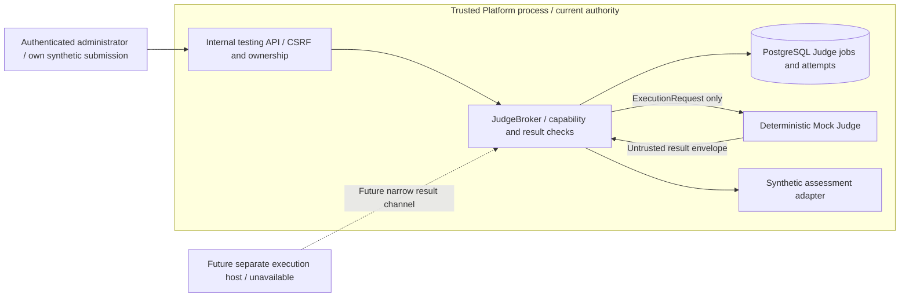
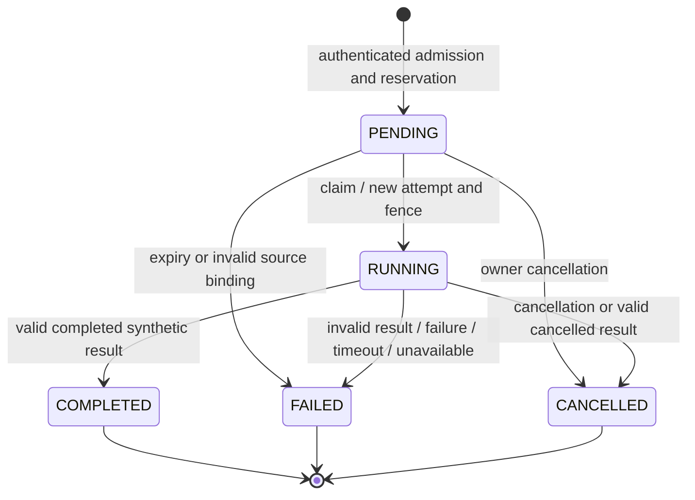

# Execution Broker foundation

M5 implements a trusted synthetic Judge broker for the localhost Platform. It coordinates a fixed in-memory Mock and validates versioned requests/results. It does not launch processes, import participant/evaluator modules, start containers, access host files or contact a network. Actual isolated execution remains unavailable; the [future isolation design](sandbox-architecture.md) defines the additional host boundary.

The Framework owns [protocol and backend contracts](../specifications/execution-protocol.md). The Platform owns authorization, PostgreSQL records, leases, opaque capabilities, admission and data lifecycle. There is no new broker service, package dependency or distributed Judge deployment.

## Components and authority

The broker has database authority and keeps a single-attempt plaintext token in memory. The Mock receives only the immutable execution request; it receives no broker object, database session, app settings, session cookie, capability token or provider credential. Process-local call separation is an interface boundary, not OS isolation. No remote capability-consumption endpoint or guest process exists in M5.

The existing AI queue remains `Job` → `WorkspaceRun` → provider/tool runtime. The new queue uses `JudgeJob` and `JudgeAttempt`, with its own state, capacity and result fields. It reuses PostgreSQL locking, database time and the existing admission-gate pattern without reusing AI call allowances or pretending synthetic CPU/memory measurements are provider tokens. Sources: `apps/api/src/praxioj_api/judge.py`, `judge_models.py`, `judge_routes.py`; Framework `execution/protocol.py`, `execution/backends.py` and `evaluation/execution.py`.

## Authenticated synthetic testing flow

`PRAXIOJ_JUDGE_BACKEND` defaults to `unavailable`; only the explicit `mock` value enables synthetic admission/dispatch. Unknown values are refused. All testing routes require a current administrator login. Writes also require the normal CSRF, origin, JSON-body and shared rate-admission controls. Administrator status never grants cross-account submission access through this harness.

| Method and route | Input | Result |
| --- | --- | --- |
| `GET /api/internal/judge/runtime` | Current administrator login | Selected availability/capabilities and public fixed fixture descriptor; no secrets |
| `POST /api/internal/judge/jobs` | `request_id` UUID, `submission_id` UUID, `fixture_id="praxioj.mock-judge/1"` | HTTP 202 and an owned persisted synthetic job |
| `GET /api/internal/judge/jobs/{job_id}` | Owned job UUID | Safe job/result/assessment projection |
| `POST /api/internal/judge/jobs/{job_id}/dispatch` | `{}` | One explicitly requested Mock delivery, followed by broker validation |
| `POST /api/internal/judge/jobs/{job_id}/cancel` | `{}` | Persisted cancellation and capability revocation |

Only a final, owned submission for the fixed `release-plan` version `1.0.0`, with the Framework's exact synthetic submission constant and verified available Trace checkpoint, is admitted. The server fixes evaluator, policy, image label, operation, limits and criteria. Request bodies cannot supply code, command, import path, URL, image, evaluator or policy overrides. There is no participant-facing execution API.

The server rechecks the immutable problem manifest digest, submission content digest, submitted-artifact digests/metadata, current account role and Trace checkpoint. A same-owner request UUID with the same submission/fixture returns the existing job; changing its binding produces an idempotency conflict. A returned completed job is not a new execution or renewed capability.

Use the dedicated synthetic smoke/integration procedure in [local setup](../development/local-setup.md). It creates only its own synthetic account/submission and explicitly enables Mock mode. Its optional `--restart-api` check restarts the named local API container after admission and verifies that a pending job survives before dispatch. Role bootstrap and restart are trusted operator Docker commands outside Mock; they are not runner capabilities or participant code execution. Existing AI workers do not poll Judge jobs; no background Judge scheduler is started by API initialization.

## Persistence, locking and lifecycle

Migration `0008_judge_execution` adds `judge_jobs` and `judge_attempts`. It leaves existing AI jobs, submissions and evaluations intact. A job stores owner/session/submission IDs, caller retry UUID, a fixed request template and source-binding snapshot/digest, deadline, output reservation, terminal result and separate synthetic assessment. An attempt stores its own UUID/request UUID, worker identity, generation/fence, capability hash/audience/operation, lease/expiry/deadline and consumed/revoked markers. Public projections exclude capability material, worker identity and the private request snapshot.

Mutations use user → solve session → Judge job → attempt locks, with shared admission last when needed. Claiming uses PostgreSQL `SKIP LOCKED` on the owner before rechecking job state. This serializes same-owner mutations and permits other unlocked accounts to progress; it is not a strict fairness guarantee. No transaction or pooled connection spans the backend await. The HTTP fixture dispatcher waits at most 30 seconds and does not run a heartbeat loop. The default Judge lease is 15 seconds, so a delayed delivery can lose authority before that local wait ends; a late result is rejected rather than silently extending the lease. The repository exposes a checked heartbeat operation for future orchestration, not a production worker loop.

M5 permits one attempt per job. There is no automatic retry after failure, cancellation, timeout or restart. A new desired test requires a new explicit request UUID; the server allocates its job UUID. Heartbeat renews only a current lease and cannot extend beyond the fixed deadline. The job deadline is at most 60 seconds from admission and is further bounded by Trace expiry. Terminalization increments the fence, revokes authority and releases active output capacity. It does not reopen a terminal job.

`complete()` verifies current authority and source bindings before parsing and accepting the result. Valid result persistence, capability consumption, assessment storage, terminal transition and reservation release share one transaction. Invalid result schemas/digests terminalize the job as failed without accepting an assessment. Wrong/stale/replayed authority is rejected. A matching current token whose authority expired or whose source/request binding drifted is rejected after committing failure, revocation and reservation release; a wrong token/audience/operation cannot cancel live work. A cancelled or completed job cannot be overwritten, even by a byte-identical replay. Cancellation and completion serialize under the same locks; the first committed terminal transition wins.

The in-memory `JudgeLease` holds a 32-byte-entropy opaque token generated with the standard `secrets` library. Its token and request are excluded from representation. Only a SHA-256 token hash is persisted; comparisons use constant-time comparison. The hash is not a reusable client credential or a signed execution attestation. See the [capability contract](../specifications/execution-protocol.md#capability-authorization).

## Resource policy and data lifecycle

| Setting, with `PRAXIOJ_` prefix | Default | Meaning |
| --- | --- | --- |
| `JUDGE_BACKEND` | `unavailable` | Explicit `mock` is the only synthetic backend selection |
| `JUDGE_ACCOUNT_ACTIVE_JOBS` | 2 | Pending plus running jobs per owner |
| `JUDGE_MAX_PENDING` / `JUDGE_MAX_RUNNING` | 16 / 2 | Shared Judge queue and running caps |
| `JUDGE_ACCOUNT_RETAINED_JOBS` / `JUDGE_SYSTEM_RETAINED_JOBS` | 32 / 256 | Retained synthetic job records, including terminal jobs |
| `JUDGE_ACCOUNT_RESERVED_OUTPUT_BYTES` / `JUDGE_SYSTEM_RESERVED_OUTPUT_BYTES` | 2 MiB / 16 MiB | Active output allowance reserved before dispatch |
| `JUDGE_LEASE_SECONDS` | 15 | Bounded lease interval; allowed 1–60 seconds |

Admission reserves 65,536 bytes per active job under the shared admission lock. Concurrent admissions cannot independently consume the same slot/capacity. Reservations are policy accounting, not physical disk guarantees. Terminal result retention remains bounded by retained-job limits and account lifecycle; finished jobs do not keep an active reservation. No provider token or monetary cost is invented for synthetic work.

Terminal Judge history remains until account erasure; M5 has no individual-job purge endpoint or periodic Judge-history pruning. Consequently the default 32-per-account/256-system retained limits can block new synthetic tests even with no active jobs. Use dedicated disposable synthetic accounts and a separately reviewed retention policy for any longer-lived harness; these caps are intentional bounded retention, not a complete operations system.

Account erasure rejects active Judge jobs until cancellation/recovery, then removes Judge records and cascaded attempts with the owning solve data. Owner exports include safe synthetic job results and exclude tokens/hashes/internal ownership. Trace expiry closes outstanding Judge work and releases its active reservation. Completed synthetic results/assessments remain account data, with expired Trace availability explicitly reported in owner exports; they contain fixed fixture output and metadata/digest references rather than copied Trace payloads. The basic Judge-job projection does not add a current Trace-availability flag; consumers needing it use the existing authorized Trace-integrity view or export. This matches the existing distinction between Trace retention and submission/artifact/evaluation retention. Audit records contain controlled identifiers, states and counts rather than raw tokens or result bodies. Standalone maintenance reconciles expired Judge jobs even when all AI workers are stopped. Current deletion and export behavior is documented in [data governance](../development/data-governance.md).

Every new enqueue/claim/heartbeat/result/cancel/recovery path checks restored-database quarantine. Backup schema registration and expected revision include the new tables. Restored jobs therefore cannot start delivering copied work. This is a serving/execution barrier, not confinement against trusted archive SQL or a database administrator; see [backup/restore](../development/backup-restore.md).

## Evaluation and remaining boundaries

A valid completed synthetic execution can contain failing criteria. Process completion does not imply full points. `assess_synthetic_execution()` (or the combined `validate_and_assess_synthetic_execution()` path used by the broker) maps the validated result into the existing `EvaluationResult` shape inside `SyntheticExecutionAssessment`, with `provenance="synthetic_mock"` and `independent_execution_evidence=false`. The broker stores that wrapper separately from the existing submission's built-in `Evaluation`. It does not regrade or replace the original score.

The M5 contracts support submitted-artifact metadata, a verified authorized Trace checkpoint, evaluator identity/version and validated result artifacts. They do not collect an OS filesystem, independently measure resource usage, execute an author evaluator or establish that participant code ran. Missing synthetic resource observations remain null; cleanup is `not_required/synthetic_no_resources`.

A1, A2, A3 and the protocol/inline-content portions of A9 are the M5 validation targets. Actual guest confinement, host quotas, egress denial, image/build isolation, OS object collection and independent teardown remain future gates. Source checks and synthetic results cannot pass those gates. See [M5 validation](../development/validation-m5.md) for actual tested scope and optimization evidence; this architecture document itself claims no test execution.

Reviewed; no justified optimization is claimed here without measurement. PostgreSQL locks and duplicate validation are evaluated in the dedicated implementation hardening pass. Removing ownership/digest checks to improve a microbenchmark would violate this architecture.
