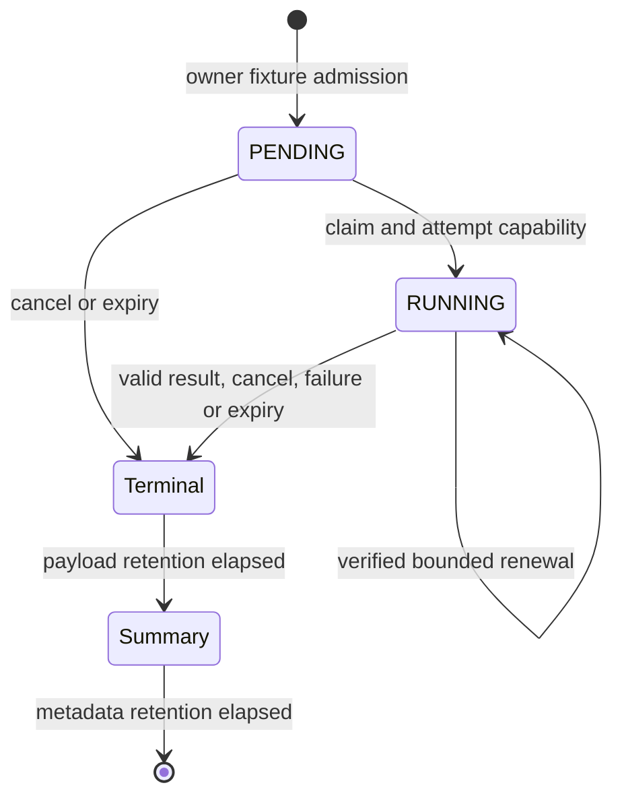

# Judge lifecycle and bounded evidence retention

[한국어](../i18n/ko/architecture/judge-lifecycle.md) · [Documentation index](../README.md)

## Overview and scope

M6-A extends the M5 synthetic Broker with acknowledged lease renewal, a dispatch heartbeat loop and two-stage terminal history cleanup. This document describes the implementation; test results and delivery status belong in [M6-A validation](../development/validation-m6a.md). [Issues #17](https://github.com/casing1/praxioj/issues/17), [#18](https://github.com/casing1/praxioj/issues/18) and [#21](https://github.com/casing1/praxioj/issues/21) track acceptance.

The Judge remains `unavailable` by default. Explicit `mock` mode accepts only an administrator's own fixed submitted fixture. Existing AI jobs, provider budgets, original Evaluation scores and Trace checkpoints stay separate. This adds no execution service, arbitrary code, host process, network transport or OS sandbox. The [Linux preflight](../development/linux-runner-preflight.md) identifies the pending M6-B host gates.

## Authority and renewal

The trusted Broker retains database authority. A `JudgeLease` pins job/attempt/worker/fence, its opaque result token and execution request. `renew(lease)` returns a `JudgeRenewal` acknowledgement or `None`; the M5 `heartbeat(lease) -> bool` facade remains supported. The acknowledgement reports database-observed server time, current lease expiry, capability expiry and fixed attempt deadline. Client timestamps never extend authority.

Renewal locks User → SolveSession → JudgeJob → JudgeAttempt and checks current active administrator, owner/source, token hash, current attempt/worker/fence, unconsumed/unrevoked state, pinned request/policy/image/input identity, available Trace and live expiry. PostgreSQL uses `clock_timestamp()` after locks; a transaction-start timestamp cannot authorize work that expired while waiting. A final time check prevents expensive source validation from reviving an expired lease. Renewal is bounded by the original attempt deadline and capability expiry. Invalid tokens cannot terminate valid work. An authenticated current capability whose source or authority has expired fails closed and releases active reservations through a committed terminal transition.

The dispatcher starts a renewal task while awaiting the backend, with an interval of one third of the configured lease. It stops and joins renewal before completion/failure, and cancels the local Mock wait if renewal is lost. No database transaction or pooled connection spans backend execution. The current synthetic dispatch wait is bounded to 30 seconds; admission also pins a maximum 60-second job deadline, further bounded by Trace expiry. These are development harness limits, not arbitrary-duration worker support or a hard real-time shutdown guarantee. Database lock/statement bounds still apply.

Cancellation and completion retain the same lock order. The first committed terminal transition wins, increments the fence, revokes the attempt and releases its active output reservation once. A stopped worker's lease expires; independent maintenance recovers it without automatically replaying execution. Delayed, replayed or cancelled results cannot overwrite an accepted assessment. M6-A still permits one attempt per job; new work is explicit.

## State and evidence lifetime

`Terminal` denotes `COMPLETED`, `FAILED` or `CANCELLED`; `Summary` is a terminal row with `evidence_purged_at`, not a runnable job state.

| Policy, with `PRAXIOJ_` prefix | Default | Behavior |
| --- | --- | --- |
| `JUDGE_LEASE_SECONDS` | 15 | Renewal interval is lease/3; allowed lease 1–60 seconds |
| `JUDGE_RESULT_RETENTION_DAYS` | 7 | Eligible terminal result/request/attempt payload is removed |
| `JUDGE_METADATA_RETENTION_DAYS` | 30 | Eligible terminal summary is deleted |
| Retention validation | `1 <= result <= metadata <= 90` | Integer days; unsupported configuration is rejected |
| Payload capacity | 32/account, 256/system by default | Existing retained-job settings bound jobs whose evidence has not been purged |
| Metadata capacity | Four times the retained-job settings | Bounds all rows, including summaries; admission fails with 429 rather than deleting protected history early |

At the first cutoff, cleanup removes the result envelope, the pinned private request and attempt records containing capability hashes. It retains the safe synthetic assessment, identifiers/digest references and lifecycle timestamps. Public job/assessment projections report `evidence_status="unavailable"` and the purge timestamp. Before purge, `available` means a stored Judge result envelope, including any produced inline artifacts, remains; `not_produced` means no result envelope was stored. It does not imply that artifacts were produced, independent execution occurred or Trace remains available. Trace retention is separately reported through export/integrity views.

At the metadata cutoff, the job and its synthetic assessment summary are removed. The original submission, built-in Evaluation and Trace are unaffected. After complete history removal, the old request UUID is no longer remembered: a new admission can create a new job UUID if its source is still eligible. Old attempt tokens never become valid for that new job. There is no permanent idempotency ledger.

## Cleanup, quotas and data governance

`JudgeBroker.purge_history(limit)` runs without a Judge backend. Maintenance first recovers expired authority, then runs bounded history cleanup alongside existing operational tasks. Scheduling independent maintenance remains an operator responsibility; elapsed TTL alone does not promise physical deletion at an exact instant. Run the existing maintenance command from [local setup](../development/local-setup.md).

The cleanup candidate query is ordered by terminal `finished_at, id` and has a partial retention index. Each candidate is rechecked under User → Session → Job → Attempt locks. Locked owners/sessions are skipped. Active jobs, young evidence and terminal anomalies with unrevoked, unconsumed, unexpired capability authority are preserved. Cleanup uses current database time, never a supplied cutoff or runner clock. Bounded per-job transactions favor safety and restartability over a broad bulk delete.

Payload purge recovers retained payload capacity; terminalization or guarded reconciliation releases active output reservations. Summary rows remain separately bounded. Repeated/concurrent cleanup rechecks state, records controlled audit identifiers/counts and does not double-release capacity. No raw result, request or token goes into audit. Account erasure still refuses active Judge work and then cascades remaining private history. Restored databases remain quarantined across authority and cleanup entry points.

Migration `0009_judge_lifecycle` follows `0008_judge_execution`, adds a nullable purge marker and terminal retention index, and preserves existing M5 records. Readiness and backup schema validation require the new head. Before upgrade, preserve an operator-managed backup under the existing policy. A schema downgrade cannot reconstruct deliberately purged evidence; review retention/data recovery separately from code rollback. Historical backups and private exports retain their existing independent lifecycle limitations.

## Compatibility, verification and limits

M5 request/result version 1.0, boolean heartbeat, fixed synthetic routes and original grading remain compatible. Safe evidence fields are additive. The separate [Runner protocol](../specifications/runner-protocol.md) uses acknowledgements without handing database or original Broker credentials to Mock.

Required tests cover renewal success and expiry, invalid token/worker/fence/source, replay/cancel/crash/late results, loop termination, retention boundaries, protected active authority, idempotence, quota/summary caps, export/account erasure, migration/quarantine and real PostgreSQL races. SQLite cannot establish row-lock behavior. Actual commands/counts, skips and independent review findings are recorded in the validation report rather than inferred here.

The dedicated optimization review measures heartbeat SQL/latency against the captured M5 workload and reviews claim/cleanup/index/serialization/locking costs. Removing authority checks is not an optimization. No application-speed or isolation improvement is asserted by this design document. CPU/memory/PID/disk/egress enforcement, guest teardown, authenticated remote deployment and actual hostile execution remain M6-B work.

## References

- [M5 Broker architecture](execution-broker.md), [execution protocol](../specifications/execution-protocol.md)
- [Data governance](../development/data-governance.md), [backup/restore](../development/backup-restore.md)
- [M6-A Milestone](https://github.com/casing1/praxioj/milestone/1), [open M6-B](https://github.com/casing1/praxioj/milestone/2)
