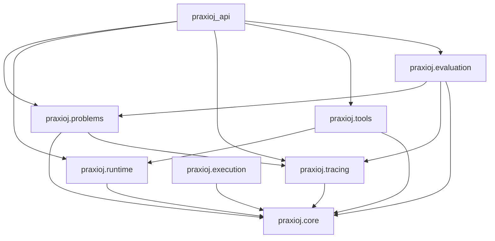

# Module boundaries

| Module | Owns | Must not own |
| --- | --- | --- |
| `praxioj.core` | Common typed domain primitives | HTTP, ORM, app configuration |
| `praxioj.problems` | Manifest schema, canonical digest, directory validation, public projection | SQL storage, authorization, evaluator imports |
| `praxioj.runtime` | Provider contract, messages, model configuration, nullable usage, mock/compatible adapters, capabilities, deadlines | Provider secrets in the browser, tool orchestration or arbitrary execution |
| `praxioj.tools` | Explicit trusted registry, input/output schemas, authorization policy, bounded logical file operations | Host filesystem, network requests, shell, dynamic plugin imports |
| `praxioj.tracing` | Versioned envelope, event types, collector/query contracts, redaction, canonical hash verification | Platform session ownership decisions |
| `praxioj.evaluation` | Input/output contracts, evidence, trusted evaluator registry and execution contract | Importing user modules, HTTP, contestant code execution |
| `praxioj.execution` | Workspace/file/tool/resource/network/artifact lifecycle interfaces | A claimed or improvised sandbox |
| `praxioj_api` | SQL models, account/role authorization, durable jobs, leases, retention, safe REST serialization | Defining author-specific task content, running untrusted code |
| `apps/web` | Participant interaction and rendering of API data | Secrets, evaluator configuration, authoritative scoring |

Arrows show allowed conceptual dependencies, not a requirement that every module imports every listed module. Dependencies flow from the Platform into the Framework. Framework imports must never refer to `praxioj_api`, FastAPI, SQLAlchemy, browser code, or database configuration. Keep common types in the lowest appropriate layer to prevent cycles.

`AIProvider`, trace collection/query interfaces, evaluator/execution contracts, and execution-backend interfaces are the extension seams. Implementing an interface does not automatically authorize it for in-process execution. A trusted operator must select provider adapters; untrusted evaluator or tool implementations require the future isolated backend.

Problem authors extend the system today through declarative, versioned manifests and supported evaluator configuration. Authors cannot currently upload a Python plugin and cause it to execute. This is an intentional limit of the safe foundation.

`praxioj_api.worker` is a separate trusted AI runtime process, backed by `jobs.py` and PostgreSQL. It owns leases, heartbeats, runtime orchestration and periodic retention cleanup. It does not execute contestant code. A future isolated Judge remains a separate boundary; implementing the current worker does not provide that sandbox.
