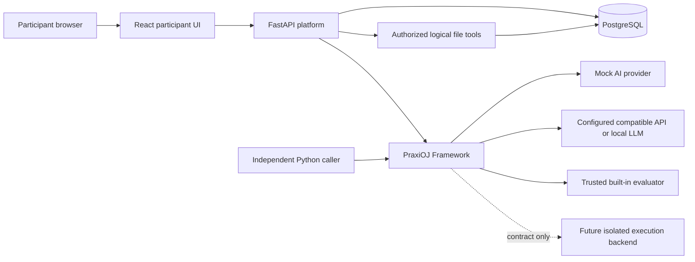
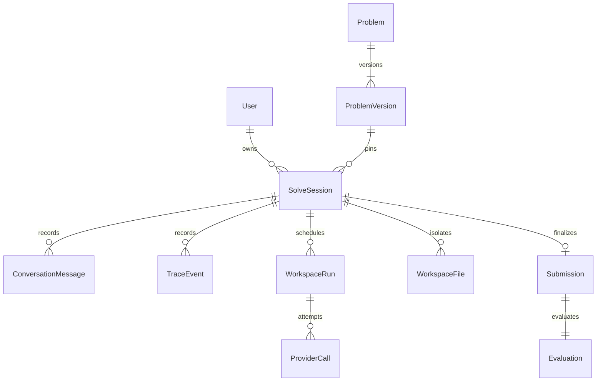

# Architecture overview

PraxiOJ is infrastructure for evaluating human–AI collaboration. Problem authors decide what task to pose, what assistance to allow, and which outcomes or observable actions matter. The platform does not ship a domain-specific curriculum or claim to measure a model's hidden reasoning.

## Framework and Platform

The Framework is the installable `praxioj-framework` distribution. It defines manifests, provider/runtime models, traces, safe logical tools, evaluation contracts, and execution interfaces using Python, Pydantic, and HTTPX. It is usable without the Platform or a database. The Platform adapts those contracts to HTTP, persistence, browser identity, and a participant UI.

M1 uses one framework distribution with separate modules, rather than six separately versioned packages. This keeps installation and coordinated contract changes simple while retaining the important import boundaries. A future extraction can preserve the module contracts; the Platform must not become a dependency of the Framework.

## Data relationships

A session pins an immutable problem version, so later registrations do not silently change its task or rubric. A submission is the final text artifact and preserves its SHA-256 digest. Its problem version is reached through its immutable session association; evaluation reaches that same version through the submission. Its evaluation records evaluator identity/version, criterion outcomes, feedback, and evidence references. Problem registration is idempotent for identical canonical content; changed content under an existing `(problem_id, version)` is rejected.

No participant route accepts an arbitrary owner/user ID as proof of identity. A server-created browser capability identifies the local demo participant. Session, trace, and evaluation queries are scoped to that identity. These boundaries are preparation for real authorization, not production authentication.

## A complete M2 solve

1. A local operator validates/registers a directory containing `manifest.json`.
2. The browser selects a problem version and permitted server runtime profile. Session creation pins model/capability/pricing settings and seeds bounded logical files from inline resources.
3. A user message and queued run are persisted atomically with a client request UUID. Identical retries return that run.
4. A single-process task reserves a model attempt, commits, then awaits the provider outside any database transaction. The full role-preserving history accompanies the request.
5. Assistant tool requests are stored, authorized separately, validated, and executed only against the session's logical DB files. Results/events commit before the next model call.
6. The UI polls state, usage and trace; it can cancel work, inspect tools/files, save drafts, or end the session. Failures remain explicit and restart recovery does not replay remote calls.
7. Final submission snapshots artifacts and supplies the authorized trace to the existing evaluator. Submission, result, and session closure commit atomically. The browser retrieves scores and evidence.

The legacy synchronous Mock/no-tools `/messages` route retains its original M1 response and event contract. New UI uses the asynchronous `/runs` path. Evaluation stays synchronous because the only implementation is a small trusted deterministic function. There is no Judge Worker, arbitrary code execution, or security sandbox.

## Decisions and tradeoffs

| Decision | Reason and limit |
| --- | --- |
| PostgreSQL plus SQLAlchemy 2 | Durable relations, uniqueness constraints, transactional session locks; SQLite is a fast test convenience only. |
| Alembic migrations | Explicit schema evolution; normal API startup never silently creates tables with `create_all`. |
| JSON manifest with inline resources | Portable and strict, with no archive extraction or arbitrary file reads in the first milestone. |
| Provider adapters with explicit capabilities | Mock works offline; compatible APIs use server-only endpoint/credential settings and bounded non-streaming requests. |
| Single-process asynchronous run loop | Allows progress/cancellation without holding DB locks over network waits; durable run records survive restart, but this is not a distributed scheduler. |
| Session-bound logical file tools | Strict schemas, allowlists, permissions and quotas; no host filesystem access or execution isolation claims. |
| Trusted built-in rubric | Demonstrates deterministic grading safely; arbitrary Python evaluator execution waits for worker isolation. |
| One immutable final submission | Clear initial session lifecycle; retries after a completed submission return a conflict rather than double grading. |
| Same-origin UI/API | Vite/nginx proxy avoids unnecessary CORS complexity; dev host/origin controls remain explicit. |
| Local browser capability | Separates local sessions while avoiding a misleading pretend login; publicly reachable deployments remain unsupported. |

Recorded versions, settings, hashes, and events support auditing. They are not a full replay system: future provider nondeterminism, omitted environment details, and external resources require more controls before reproducibility can be claimed.
