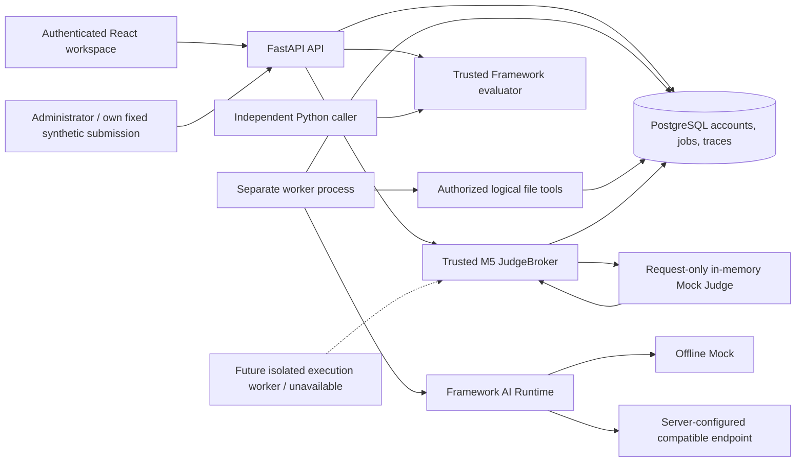
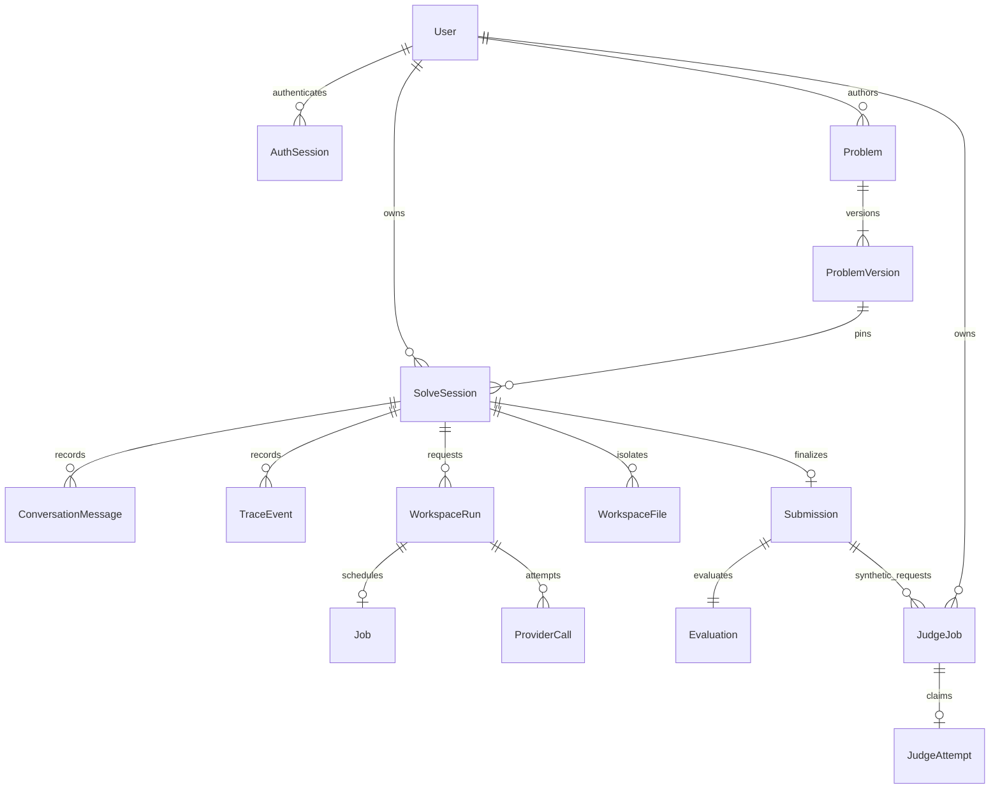

# Architecture overview

PraxiOJ supplies infrastructure for evaluating observable human–AI work. Authors choose tasks, permitted assistance and criteria. Framework and Platform remain independent: the installable Framework never imports FastAPI, SQLAlchemy or browser code.

## Boundaries and lifecycle

1. A participant registers with a generic acknowledgement, then explicitly signs in. Argon2id verifies passwords; random HttpOnly session cookies refer to hashed server-side records with fixed expiry. CSRF headers protect authenticated writes. Registration grants only participant status. Shared atomic IP/account throttles bound authentication attempts; password changes revoke all logins, and private-data actions require recent password confirmation on the current login.
2. An author publishes a strict declarative manifest through an authorized API. A trusted local operator can register examples. Problem versions are immutable and sessions pin a version, profile, model policy and retention deadline.
3. The API atomically admits account/system resource capacity and stores the user message, Run, PENDING Job and trace. Calls reserve daily account/problem/system allowance before provider I/O; unknown or estimated usage retains conservative policy reservations without inventing actual tokens. A request UUID identifies a retry; different content under the same UUID conflicts.
4. A worker claims a job with PostgreSQL locks, assigns a lease/token/fence and commits before provider I/O. Heartbeats renew the lease. Every result/tool/terminal transaction rechecks ownership. The API has no background execution task.
5. Tool requests are separately validated and authorized before operating on session-local database text files. Nothing executes shell commands, participant Python, containers or general network tools.
6. Persistent cancellation revokes ownership. An expired lease becomes a failed job with explicit uncertainty; the remote call is not silently replayed. Pending work survives API/worker restart. Workers drain on graceful shutdown. A separate bounded maintenance command can reconcile stale work while all workers are stopped; its scheduling remains an operator responsibility.
7. Submission snapshots text and artifacts, collects authorized trace/usage, and invokes a trusted deterministic Framework evaluator. Final and process criteria can be composed independently. Scores cite observable evidence; they do not establish human understanding.
8. Trace v1.1 is append-oriented with a SHA-256 chain and a stored session checkpoint. Review reads lock the session while comparing events and checkpoint. Legacy traces remain unverified. Retention removes expired trace payloads and records a minimal separate deletion audit.

9. An administrator can explicitly test a fixed synthetic submission through the M5 internal Judge harness. The broker pins a versioned request and policy, reserves capacity, claims a one-attempt capability and validates Mock output before storing a separate synthetic assessment. It rechecks current ownership/fence/lease/digests, never sends application credentials or tokens to Mock, and never replaces the existing evaluation. Default Judge mode is unavailable; no participant code or remote runner is enabled.

## Persistence

`AuthRateLimit` stores bounded hashed login buckets; `AuditRecord` stores operational metadata separately from participant events. Migrations 0003–0005 add accounts, jobs, and retention/checkpoints. Additive M4 migrations 0006–0007 add per-login reauthentication, quota/reservation and worker telemetry records. M5 migration 0008 adds separate Judge jobs/attempts with hashed opaque capabilities, pinned snapshots, output reservations and synthetic results/assessments; it does not rewrite M4 data. Old browser identities retain their data but cannot log in, claim a new account, or become administrators. Old unfinished runs are quarantined, not replayed. No migration rehashes old evidence as proof of its original integrity.

Owner-only bounded exports exclude credentials and private evaluator configuration. Account erasure locks the owner/sessions and removes participant content in one transaction, retaining an inactive pseudonymous reference for authored public problems. Operator backups use PostgreSQL tools, verify native/container target identity and restore only into new quarantined databases. Historic copies require external erasure reconciliation before any future promotion; no promotion command exists.

## Compatibility and limits

Original M1/M2 manifest digests and Mock/provider contracts remain supported. Existing Run statuses remain `queued/running/completed/failed/cancelled`; the added Job projection exposes `PENDING/RUNNING/COMPLETED/FAILED/CANCELLED`. The legacy synchronous Mock/no-tool `/messages` route remains authenticated and bounded. Evaluation remains synchronous because only small trusted deterministic built-ins execute in process.

PostgreSQL provides durable transactions and row locks. SQLite is a unit-test convenience and does not establish worker concurrency safety. There is no additional message-broker service. M5 JudgeBroker is a trusted application component backed by the same database, with separate Judge state from the AI queue. Multiple worker processes are tested; this is not a distributed untrusted-code Judge or a production operations system. The network stack stays on localhost. M4 supplies atomic quotas, bounded database waits and payload-free request metrics; it does not provide production DDoS protection or distributed monitoring. Full public deployment hardening, account recovery/MFA, encrypted secrets/storage, externally anchored integrity and an execution sandbox remain future work.

See [authentication](../development/authentication.md), [resource quotas](resource-quotas.md), [worker lifecycle](persistent-jobs.md), [retention](trace-retention.md), [evaluation](../specifications/evaluation-contract.md), [Execution Broker](execution-broker.md), [execution protocol](../specifications/execution-protocol.md), and [security boundaries](../../SECURITY.md).
