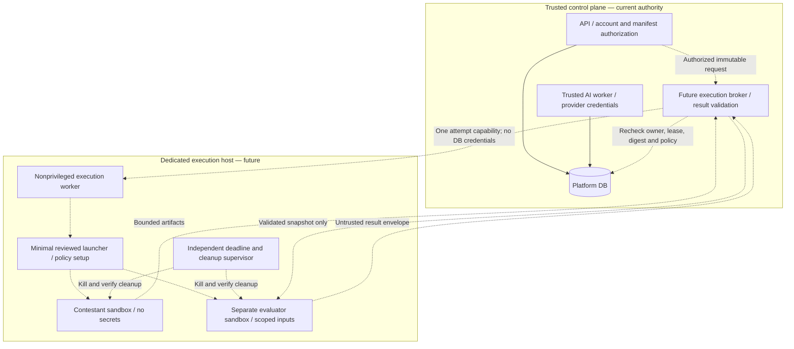

# Future execution-isolation architecture proposal

**Status: design only.** M4 does not enable arbitrary code, a terminal, untrusted containers or external evaluator execution. Public deployment remains unsupported. This proposal is separate from the current trusted AI worker and implements no executable sandbox. The [threat model](sandbox-threat-model.md) records present controls, effective resources, attacker stories and limitations.

## Present boundary and decision

The current worker receives the same Compose database/provider environment as the API and has outbound network access. Its leases protect against stale writes, not malicious execution with those credentials. Its tools operate on logical database records. The Framework execution methods fail closed and the evaluator registry includes only compiled-in trusted evaluators. Sources: `compose.yaml:95`, `compose.yaml:102`, `apps/api/src/praxioj_api/jobs.py:49`, `apps/api/src/praxioj_api/workspace.py:8`, `packages/framework/src/praxioj/execution/__init__.py:45`, `packages/framework/src/praxioj/evaluation/__init__.py:276`.

The proposed first supported runner is a **separate nonprivileged execution service on a dedicated, disposable Linux execution host/VM**, with one sandbox per job attempt. The API and trusted AI worker remain in the control plane. The execution service receives no platform DB connection, provider key, session cookie, repository checkout, backup mount or Docker administrator socket. It obtains one narrowly scoped job capability from a broker. Linux host/runtime selection is a prerequisite; native macOS/Windows and Docker Desktop must not silently fall back to host subprocesses or ordinary containers.

For hostile arbitrary code, evaluate a Firecracker microVM backend first when a supported KVM host is available, and gVisor as an alternative subject to workload compatibility and the same acceptance gates. This is a proposed evaluation order, not a measured security/performance ranking. Rootless containers can support trusted development harnesses and layered least privilege, but rootless mode alone is insufficient evidence to approve hostile-code execution.

| Candidate | What official documentation establishes | PraxiOJ decision and unresolved work |
| --- | --- | --- |
| Firecracker microVM | Uses KVM/virtualization for isolation; production guidance requires patched components, restrictive seccomp, jailer-equivalent constraints and bounded host output | Candidate for hostile workloads on dedicated Linux/KVM hosts. Verify image/kernel provenance, jailer setup, VMM limits, output handling and teardown. No installation or runtime exists here |
| gVisor `runsc` | An application kernel mediates workload system calls; Sentry/Gofer and host controls form its architecture. It does not protect against higher-level orchestration bugs or unsafe resources already granted to a workload | Alternative candidate; prove required language/syscall compatibility, resource enforcement, no network and per-job isolation. Reject unsupported workloads instead of switching runtimes |
| Rootless OCI container | Docker daemon and containers run in a user namespace without root privileges; seccomp constrains allowed syscalls | Useful defense in depth; does not by itself establish a separate kernel boundary. Do not equate a non-root user in the existing API Dockerfile with rootless execution or sandbox approval |

Technical references, consulted 2026-11-10: [Firecracker production host guide](https://github.com/firecracker-microvm/firecracker/blob/main/docs/prod-host-setup.md), [gVisor architecture/security introduction](https://gvisor.dev/docs/architecture_guide/intro/), [Docker rootless mode](https://docs.docker.com/engine/security/rootless/), [Docker seccomp profiles](https://docs.docker.com/engine/security/seccomp/). The decisions and requirements below are PraxiOJ proposals, not vendor guarantees.

## Components and authority

The privileged setup component, if required by the selected runtime, is part of the trusted computing base. It may accept only fixed image IDs and validated policy values from the execution service, never caller-supplied host paths, arbitrary runtime flags or shell text. It must drop privileges before hostile code starts. “Nonprivileged execution worker” does not mean a privileged launcher is magically absent; the exact supported launcher authority must be separately documented and reviewed.

The Framework keeps pure contracts for execution requests, limits, artifact metadata and results. Runtime-specific lifecycle code, broker authentication and storage adapters belong outside the standalone Framework's web/ORM-free core. No handler registration or manifest field may import a participant package in the API or trusted AI worker.

## Request, capability and result protocol

1. The API authenticates the caller, checks problem/session ownership and pinned version policy, reserves shared capacity, then records an execution request. Existing owner and retry-digest patterns remain authoritative: `apps/api/src/praxioj_api/services.py:18`, `apps/api/src/praxioj_api/workspace_routes.py:32`.
2. The broker constructs an immutable manifest binding account/session/job IDs, attempt/fence, input digest, problem/evaluator version, image digest, policy digest, maximum output, deadline and allowed operation. The client cannot substitute these fields. Resolve the account and policy server-side.
3. Issue a short-lived audience-bound capability for that single attempt and broker operation. Use an established authenticated channel and token mechanism, with revocation/fence checks on every upload/read/result; do not invent cryptography. The supervisor holds this token; the guest receives only its local input/output channel and no reusable platform credential.
4. The service verifies input bytes/digests before launch and rechecks the policy/runtime support. No missing limit, unknown runtime, failed image verification or absent isolation facility may trigger fallback execution.
5. The guest runs once on a fresh immutable input snapshot. Its output is untrusted data even after successful exit. The broker validates size, schema, job binding and digests, rechecks current ownership/lease/deletion/cancellation, then writes the accepted result transactionally.
6. Cancellation first invalidates broker authority, then requests destruction. A host watchdog kills the complete sandbox independently of guest cooperation. Late uploads/results remain rejected. Network/provider effects remain potentially uncertain; a crash never justifies silent replay.

The current lease tuple is a useful control-plane precedent, not a safe capability to expose directly to the guest: `apps/api/src/praxioj_api/jobs.py:23`, `apps/api/src/praxioj_api/jobs.py:49`, `apps/api/src/praxioj_api/jobs.py:86`. The future broker must not expose general SQL, arbitrary file downloads or trusted trace-event append methods.

## Isolation policy and enforcement owners

| Surface | Proposed required policy | Enforcement owner / fail-closed behavior |
| --- | --- | --- |
| Identity/privilege | Dedicated unprivileged service identity; guest non-root where feasible; no capabilities, privilege escalation, host PID/IPC/user namespace sharing or privileged mode | Host launcher/runtime verifies actual effective settings before launch; unavailable policy rejects the job |
| Secrets | Explicit minimal environment such as fixed locale and working directory; no inherited platform environment, provider keys, DB URLs, cookies, SSH agent or cloud credentials | Broker/launcher build an allowlisted environment. Secret canary tests must show absence in env, files, proc views, logs and output |
| Filesystem | Read-only digest-pinned root; read-only per-attempt input; fresh bounded scratch/output; no repository/home/DB/backup/runtime-socket mounts; no writable shared cache | Runtime/host mounts and permissions, independently bounded storage; reject unknown host paths and reuse |
| Processes/syscalls | Drop unnecessary capabilities; no-new-privileges; runtime-approved restrictive seccomp; enforcing AppArmor/SELinux or an explicitly reviewed equivalent | Host checks the active profile rather than a configuration label. Never use unconfined as a compatibility fix |
| Network | Default deny: no guest external/host/LAN/metadata/DB/provider access, DNS or inherited proxy. No membership in current Compose local/backend networks | Runtime network configuration plus host firewall/namespace policy. Independent probes must verify IPv4/IPv6, UDP/TCP and host gateways |
| Optional network | Separate future proposal only: broker selected fixed services, validate resolved addresses and redirects, bound requests and never forward secrets | Broker and egress infrastructure, not model instructions or hostname syntax alone |
| CPU/memory/PIDs | External per-job and aggregate host caps; process tree or whole VM terminated on breach; include launcher/VMM/collector overhead | Host cgroups/runtime and independent watchdog; admission reserves resources before launch |
| Disk/output | Bounded writable storage, inode/file-count caps, bounded stdout/stderr/log buffers and artifact bytes | Host storage quota/volume and collectors, not a guest-reported size |
| Dependency/package | No install hooks or builds in control plane; offline reviewed/pinned package set; hostile builds receive their own equal isolation | Image/build pipeline with digest, provenance and license review; no runtime package download by default |
| Evaluator | Distinct sandbox from contestant; receives only required immutable submission/evidence; hidden rubric not exposed to contestant; no direct score write | Broker provides scoped input and validates evaluator output. External evaluator is untrusted even when author-supplied |
| Cleanup | Fresh sandbox per attempt; revoke capability, stop entire tree/VM, remove temporary resources, verify teardown and quarantine host on failure | Independent supervisor/reaper; do not acknowledge reusable capacity until cleanup is established |

Docker's default seccomp profile is an allowlist, and rootless mode reduces daemon/runtime privilege. Neither substitutes for validating the complete workload policy. See [Docker seccomp](https://docs.docker.com/engine/security/seccomp/) and [rootless mode](https://docs.docker.com/engine/security/rootless/). Firecracker explicitly treats guest-influenced serial/log output as host resource usage requiring bounds; include that channel in the collector budget. See [Firecracker host guidance](https://github.com/firecracker-microvm/firecracker/blob/main/docs/prod-host-setup.md).

### Candidate limits for a synthetic prototype

These are **proposed starting budgets**, not implemented settings, measured requirements or billing guarantees. A backend must either demonstrate enforcement for the entire attempt or reject it. Measure runtime/VMM overhead separately before selecting host admission capacity.

| Resource | Candidate per-attempt budget | Boundary behavior to verify |
| --- | --- | --- |
| CPU / elapsed time | 1 vCPU share, 30 CPU-seconds, 60 seconds total wall time including startup and collection | Independent watchdog terminates on deadline; guest clocks/signals cannot extend it |
| Memory | 256 MiB workload memory, swap disabled; additional measured host runtime budget reserved | OOM is a bounded job failure; neighbor and API remain responsive |
| Processes | 64 guest processes; separately cap supervisor/runtime host tasks | Fork pressure cannot escape per-job or host aggregate limits |
| Writable storage | 64 MiB and 1,024 files/inodes, including scratch/output | Actual storage accounting rejects excess; sparse files/metadata do not evade the cap |
| Output | 1 MiB combined stdout/stderr and 8 MiB/100 regular output files | Drain/terminate safely without unbounded buffering; return explicit limit status |
| Network | None | Host, LAN, metadata, Internet and peer jobs all unreachable |
| Prototype concurrency | 1 isolated attempt per execution host initially | Increase only after measured resource/cleanup behavior and host reserve review |

Existing Framework defaults include 30 CPU-seconds, 256 MiB memory, 64 MiB disk and deny-network fields, but have no executing enforcement implementation: `packages/framework/src/praxioj/execution/__init__.py:10`. Application quotas continue separately; a sandbox limit must not be reported as a measured token cost.

## Artifact and evaluator output handling

The collector must treat filenames, bytes, metadata and protocol responses as hostile. Do not mount a guest-produced filesystem into the control-plane host as a trusted filesystem, or extract an archive directly into the repository/storage root. Prefer a bounded transfer of individually named regular files into fresh staging. If archive support is later necessary, parse it in a separate constrained process and validate expanded bytes/counts before persistence.

Use descriptor-relative traversal under an already opened output directory; reject absolute paths, dot components, ambiguous encodings, symlinks, hardlinks, devices, sockets and FIFOs. Validate types after open, avoid follow-link races and recompute size/content digest on the accepted byte stream. Treat sparse-file logical size, inode counts and decompression expansion as limits. Current logical path validation is a useful input contract but does not solve OS path resolution: `packages/framework/src/praxioj/tools/__init__.py:19`.

Validate a strict, versioned result envelope with bounded depth, lists, strings and finite numeric scores. Enforce criterion IDs and maximum scores against the pinned problem, not evaluator-supplied claims. Reject unknown fields where they could carry authority. The broker supplies authoritative identities, sequence numbers, timestamps and execution status; guest text cannot become a privileged message, SQL, markup, shell command or trace event. Render output as text and force downloads for untrusted binary/HTML artifacts.

Record input/image/policy/result digests, runtime/version, enforcement decision, measured resource usage, exit reason and cleanup outcome without raw secrets. An output digest proves byte identity, not correctness or truthfulness. Never claim hidden reasoning, complete tamper-proof evidence or deterministic external model replay.

## Threat-to-control and acceptance mapping

All acceptance gates below are **pending for future execution**. They describe required evidence; no test result or approval is claimed by this document.

| Gate | Threat coverage | Required evidence before enabling hostile workloads |
| --- | --- | --- |
| A1 — default off | F1, T7 | Unsupported backend/runtime and absent host facilities produce a safe unavailable result. No code path executes contestant/evaluator code in API, AI worker, migrations or startup; Framework remains independent |
| A2 — API boundary | T1, T2, T5 | Positive own-account flow; negative anonymous/cross-account/author-role/CSRF/origin cases; revoked/expired session and oversized body cases; rate-store outage fails closed |
| A3 — capability/fence | T1, T3, T4, F6 | Wrong account/session/job/attempt/audience/digest, replay, expired capability, cancellation and lease replacement all deny read/write/result acceptance; concurrent races run against disposable PostgreSQL |
| A4 — secret/authority exclusion | F1, F2, T6 | Synthetic canaries in control-plane env/storage remain unreadable; no DB/provider credentials, host mounts, runtime sockets or inherited agents; effective UID/capabilities/profile are recorded |
| A5 — host/session isolation | F1, F2 | Two simultaneous synthetic jobs cannot see each other's memory/processes/files; clean next-job state; representative namespace/mount/privilege denials; supported kernel/runtime versions and patch policy recorded |
| A6 — egress | F4, T6 | IPv4/IPv6 TCP/UDP/DNS probes to synthetic host/LAN/metadata/peer endpoints are denied; bridge, inherited proxy and resolver changes do not bypass policy; no external live targets needed |
| A7 — resource bounds | T5, F5 | Synthetic CPU, allocation, fork, file/inode and output pressure is contained to the stated bounds/tolerance; host and API remain responsive; runtime overhead/cleanup resources included |
| A8 — packages/evaluators | T7, F6, F7 | Tampered image/digest and unauthorized package/hook denied; builds isolated; evaluator cannot read contestant neighbor/control-plane secrets or write DB scores; required language compatibility documented |
| A9 — result/artifact parser | T3, F3, F6 | Valid bounded files pass; traversal, links, special files, malformed JSON, duplicate IDs, excessive nesting/count/bytes, nonfinite scores and score-policy violations are rejected |
| A10 — failure/teardown | T4, F5 | Cancel, guest crash, execution-worker kill, broker outage and host restart revoke acceptance and terminate/reap work; orphan detection is independent; stale results rejected; no automatic external replay |
| A11 — retention/recovery | T8, T9 | Restored DB cannot start API, claim work or run maintenance; mismatched/unavailable cluster identity denies backup/restore work; current deletion decisions block future promotion when absent; downloaded copies documented separately |
| A12 — review and measurement | All | Dedicated optimization/hardening review, independent security review, pinned runtime/host evidence, positive/negative/boundary regression results and comparable baseline/candidate measurements with skips disclosed |

The present restore checks remain useful but independent: `apps/api/src/praxioj_api/backup.py:96` binds native and subprocess database identity; `apps/api/src/praxioj_api/backup.py:214` installs quarantine before restore; `apps/api/src/praxioj_api/backup.py:238` revokes restored sessions. API startup, worker claim and maintenance check quarantine at `apps/api/src/praxioj_api/main.py:54`, `apps/api/src/praxioj_api/jobs.py:105` and `apps/api/src/praxioj_api/maintenance.py:15`. There is no automatic promotion or malicious-archive confinement. Historical backup/client-copy erasure requires the separate [data governance](../development/data-governance.md) and [backup](../development/backup-restore.md) procedures.

Acceptance tests must use disposable local infrastructure, synthetic data and controlled fixtures after explicit implementation authorization. Escape probes require a separately scoped security exercise; this document does not authorize running exploits or untrusted code. No paid/live LLM service is needed.

## Phased implementation and review plan

| Phase | Deliverable | Exit condition |
| --- | --- | --- |
| 0 — M4 design, current | Threat model, boundaries, proposal and acceptance matrix; execution remains unavailable | Docs/source consistency, unresolved assumptions stated; no runtime enablement |
| 1 — contracts and broker prototype | Versioned immutable request/result schemas, narrow capability interface, mock backend, capacity reservations | A1–A3/A9 contract and authorization tests; no guest execution; choose host/backend requirements |
| 2 — isolated synthetic harness | Dedicated local Linux host/VM, pinned backend/image, nonprivileged supervisor and independent reaper | Explicitly authorized synthetic workloads; A4–A7/A10 measured; no participant entry point |
| 3 — adversarial evaluation | Packages/evaluator separation, controlled parser/containment tests, patch and incident procedures | A8/A9 and independent scoped security review; findings remediated or feature remains blocked |
| 4 — complete integration | Brokered API workflow, durable state, cancellation, privacy/retention, operational admission | A1–A12 pass with actual outputs/skips; dedicated post-implementation optimization/hardening pass and maintainer sign-off |
| Separate decision — exposure | Any proposal to support real users, public service or broader network capability | New deployment/privacy/abuse review; never implied by local isolation acceptance |

Capture baseline API/queue behavior with no runner, then compare each candidate on the same host, pinned images and synthetic workload: cold start, p50/p95 completion, peak resident/guest memory, CPU, disk/inodes, bounded output, concurrent throughput, cancellation-to-death and cleanup-to-reuse. Record sample counts and resource overhead; preserve failures. Optimize only identified bottlenecks without widening syscall/network/credential policy. Reviewed; no justified optimization in this documentation change because it creates no executing path and supplies no performance measurements.

The outstanding decisions are supported Linux/kernel/KVM environment, selected runtime and language matrix, privileged-launcher scope, protocol/token implementation, external resource-accounting mechanism and retention of isolated-job evidence. They must be resolved before phase 2 or the affected later gate, not assumed from a vendor name.
