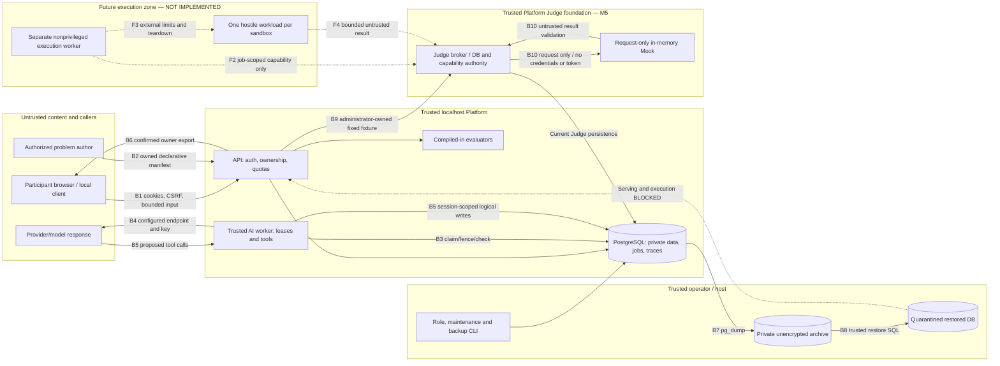

# Execution-isolation threat model

## 1. Overview

This is a source-backed M5 architecture and future-isolation document for PraxiOJ, an independent personal Apache-2.0 Framework and Platform. It describes the current localhost development preview and the additional boundaries needed **before** arbitrary contestant code, packages or external evaluators could be enabled. No executable sandbox, public deployment approval or production certification is introduced.

The review covers the M5 working tree and retains the M4 operational, data-governance and backup boundaries. M5 adds a synthetic Judge protocol/broker; it does not add a hostile-code runner. The M4 independent review remains historical evidence. A fresh-context independent M5 review mapped 29 effective-resource rows and resolved the current/future boundaries; this model incorporates those facts plus retained M4 logical-tool, AI-job and storage controls. Its raw review and the final source snapshot are retained through managed Codex Security storage. This is architecture analysis, not a completed vulnerability audit. Source citations identify repository-relative paths and inspected lines; the snapshot footer covers the cited source inventory, not an assertion that HEAD contains all reviewed changes.

PraxiOJ M5 is a localhost personal development preview with a standalone Python Framework and an authenticated Platform API, PostgreSQL persistence, React UI, and separate trusted AI worker. M5 adds a process-local trusted JudgeBroker, separate JudgeJob/JudgeAttempt records, strict version-1.0 messages, an explicitly synthetic assessment bridge, a deterministic request-only in-memory Mock, and an unavailable backend. It adds no sandbox process, remote runner/result-upload channel, general code execution or public deployment. API setup installs the broker independently of the AI RunManager (apps/api/src/praxioj_api/main.py:51-80); the existing worker owns only trusted AI runtime work (apps/api/src/praxioj_api/worker.py:122-147); Framework imports/contracts remain independent of Platform infrastructure (packages/framework/src/praxioj/execution/protocol.py:1-10, packages/framework/src/praxioj/execution/__init__.py:36-46). Sources: `packages/framework/src/praxioj/execution/__init__.py:36`, `packages/framework/src/praxioj/execution/__init__.py:49`, `apps/api/src/praxioj_api/worker.py:122`, `compose.yaml:104`.

| Component | Current responsibility | Source |
| --- | --- | --- |
| Browser/API | Account lifecycle, owner access, declarative problem publication, export and deletion | `apps/api/src/praxioj_api/auth_routes.py:67`, `apps/api/src/praxioj_api/security.py:19`, `apps/api/src/praxioj_api/main.py:51` |
| PostgreSQL | Accounts, solve data, jobs, admission budgets, trace checkpoints and audit | `apps/api/src/praxioj_api/database.py:8`, `apps/api/src/praxioj_api/quotas.py:38` |
| Trusted AI worker | Claim/renew leases, provider calls and logical tool orchestration | `apps/api/src/praxioj_api/worker.py:52`, `apps/api/src/praxioj_api/runs.py:251` |
| Framework tools | Explicit handler registry; permission-checked logical read/write | `packages/framework/src/praxioj/tools/__init__.py:177`, `packages/framework/src/praxioj/tools/__init__.py:230` |
| Trusted evaluator | Fixed compiled-in evaluator IDs/versions; separate explicitly synthetic assessment adapter | `packages/framework/src/praxioj/evaluation/__init__.py:276` |
| Synthetic Judge broker | Administrator-owned fixture admission, source binding, output reservation, current-attempt capability and result validation | `apps/api/src/praxioj_api/judge.py:126`, `apps/api/src/praxioj_api/judge_routes.py:44`, `apps/api/src/praxioj_api/judge_models.py:10`, `apps/api/migrations/versions/0008_judge_execution.py:5` |
| Mock backend | Request-only deterministic fixture; no code, network, process or filesystem execution | `packages/framework/src/praxioj/execution/backends.py:27`, `packages/framework/src/praxioj/evaluation/execution.py:25` |
| Operator workflows | Local role assignment, manifest registration, maintenance and trusted backup/restore | `apps/api/src/praxioj_api/cli.py:11`, `apps/api/src/praxioj_api/maintenance.py:15`, `apps/api/src/praxioj_api/backup.py:72` |

### Effective resources and configuration

Values below are source defaults or formulas. Actual environment values, secrets, databases, Docker state and browser download directories were not inspected. Native commands consume the process environment; they do not themselves load a private dotenv file. Compose substitutes the named settings into a shared API/worker environment. Credentials are represented only by references.

| Deployment or workflow | Resource or capability | Configuration and precedence | Safe effective value or location | Readers, writers, or recipients | Enforcing control | Evidence or unknowns |
| --- | --- | --- | --- | --- | --- | --- |
| native | API HTTP listener | make api -> Uvicorn | 127.0.0.1:8000; no proxy headers/access log | Local clients | Listener bind plus API auth/Host/origin/CSRF/rate controls | `Makefile:27-28`, `apps/api/src/praxioj_api/security.py:92-150`; Unsupported manual non-loopback launch is operator configuration, not an implemented transport-locality check. |
| Compose | API HTTP listener | Dockerfile CMD -> scripts/start-api.sh; Compose ports/networks | Container 0.0.0.0:8000; host 127.0.0.1:8000; backend and local networks | Local clients and connected container peers | Host loopback publication and application controls | `apps/api/Dockerfile:13`, `scripts/start-api.sh:7`, `compose.yaml:87-111` |
| native | Web HTTP/proxy | make web -> Vite server | 127.0.0.1:5173; /api -> http://127.0.0.1:8000; preview loopback 4173 | Browser/API | Loopback bind; API authorization remains authoritative | `Makefile:36-37`, `apps/web/vite.config.ts:6-12` |
| Compose | Web HTTP/proxy | nginx config copied into image; Compose port publication | Host 127.0.0.1:5173 -> container 80; static /usr/share/nginx/html; /api -> http://api:8000; Host preserved | Browser/API/local network peers | Loopback publication; API guards; no forwarding-header trust | `apps/web/Dockerfile:8-11`, `docker/nginx.conf:1-20`, `compose.yaml:113-127` |
| native API/worker | Platform database | Explicit Settings wins in create_app; else database_url argument -> process DATABASE_URL -> Settings default; worker uses process Settings | Default loopback 127.0.0.1:5432/praxioj; configured role/credential references | API, trusted AI worker, local DB | DB privilege boundary; PostgreSQL backend validation; bounded pool/connect/query/lock waits; SQLite test-only | `apps/api/src/praxioj_api/main.py:51-53`, `apps/api/src/praxioj_api/settings.py:25-28`, `apps/api/src/praxioj_api/settings.py:154-157`, `apps/api/src/praxioj_api/database.py:8-27`, `apps/api/src/praxioj_api/worker.py:122-147` |
| Compose API/worker | Platform database | compose runtime_environment DATABASE_URL -> same alias for worker -> Settings -> engine | db:5432/praxioj; identical configured database role reference in API and worker | API, trusted worker, PostgreSQL | Network and application controls; no separate database authority between API and worker | `compose.yaml:22-24`, `compose.yaml:100-111` |
| base Compose | PostgreSQL persistent storage/listener | postgres:18.6-bookworm -> named postgres_data volume; backend network | postgres_data mounted /var/lib/postgresql; DB has no published host port | PostgreSQL; trusted Docker/host administrators | Volume/network authority | `compose.yaml:3-16`, `compose.yaml:129-136`; Image-defined PGDATA child and host backing path were not inspected; mount root alone is not their complete effective value. |
| optional native Compose override | PostgreSQL host listener | compose.yaml + compose.native.yaml override | Host 127.0.0.1:5432 -> DB container 5432; adds local network | Native API/worker/operator | Loopback publication; configured DB auth | `compose.native.yaml:1-7` |
| native | AI provider endpoint/credential | Process PRAXIOJ_LLM_BASE_URL/MODEL/API_KEY -> Settings -> permitted profile -> adapter | Offline Mock default; configured base_url.rstrip('/') + '/chat/completions'; key reference becomes Authorization: Bearer | Configured provider; trusted API/AI worker | Endpoint validation, profile/manifest restrictions, no inherited HTTP proxy/redirect, bounded bytes/deadline | `apps/api/src/praxioj_api/settings.py:29-39`, `apps/api/src/praxioj_api/settings.py:158-166`, `apps/api/src/praxioj_api/runs.py:80-112`, `apps/api/src/praxioj_api/runs.py:282-294`, `packages/framework/src/praxioj/runtime/compatible.py:41-68`, `packages/framework/src/praxioj/runtime/compatible.py:107-129` |
| Compose API/worker | AI provider configuration/egress | Compose named interpolation -> shared runtime environment -> Settings/adapter | Same provider references in API and worker; Mock default; both have outbound-capable local bridge | API/worker/configured provider | Adapter/application controls; internal backend network does not deny egress | `compose.yaml:25-36`, `compose.yaml:98-111`, `compose.yaml:132-136` |
| native API | Judge backend selection | Explicit Settings constructor fields win; else process PRAXIOJ_JUDGE_BACKEND -> default -> selected backend/broker | unavailable default; explicit mock only; unsupported values reject settings | Trusted API/broker; authenticated administrator may inspect runtime | Settings enum, broker enabled gate and dispatch gate; no host fallback | `apps/api/src/praxioj_api/main.py:51-53`, `apps/api/src/praxioj_api/settings.py:92-114`, `apps/api/src/praxioj_api/judge.py:130-132`, `apps/api/src/praxioj_api/judge_routes.py:44-48`, `apps/api/src/praxioj_api/judge_routes.py:84-93` |
| Compose API | Judge backend selection | Compose environment interpolation -> PRAXIOJ_JUDGE_BACKEND -> Settings | unavailable default, explicit mock only; no new host port/service; worker receives settings but does not poll Judge jobs | API broker; ordinary AI worker retains existing authority | Same enum and gates as native; independent AI queue | `compose.yaml:72-80`, `compose.yaml:100-111`, `apps/api/src/praxioj_api/judge_routes.py:44-48`, `apps/api/src/praxioj_api/worker.py:122-147` |
| native/Compose API | Synthetic Judge HTTP surfaces | Local guard -> require_role(administrator) -> broker owner/fixture/source binding | GET /api/internal/judge/runtime; POST /jobs; GET /jobs/{id}; POST /jobs/{id}/cancel and /dispatch; job prefix /api/internal/judge; exact owned final release-plan/1.0.0 fixture | Current administrator on own source/job only | Authentication/CSRF/Host/origin/JSON/body/rate; narrow create/empty mutation schemas; DB role/ownership/final-state/digest/Trace checks | `apps/api/src/praxioj_api/judge_routes.py:15-22`, `apps/api/src/praxioj_api/judge_routes.py:54-93`, `apps/api/src/praxioj_api/security.py:19-58`, `apps/api/src/praxioj_api/security.py:92-150`, `apps/api/src/praxioj_api/judge.py:60-107`, `apps/api/src/praxioj_api/judge.py:134-172`; Administrator-owned synthetic test harness, not participant execution API. Route word internal does not create a separate network listener or isolation boundary. |
| native/Compose broker | Judge coordination/admission | Configured Platform session factory -> JudgeJob/JudgeAttempt -> shared admission gate | Separate Judge tables/state; 65536-byte active reservation/job; defaults 2 active/32 retained per account,16 pending/2 running/256 retained globally,2 MiB/16 MiB reserved-output account/system; deadline min(DB now+60s,Trace expiry) | Trusted broker with Platform DB role; not Mock | User/session/job/attempt locks; owner SKIP LOCKED claim; admission lock; immutable spec; terminal release | `apps/api/src/praxioj_api/judge.py:173-217`, `apps/api/src/praxioj_api/judge.py:230-312`, `apps/api/src/praxioj_api/settings.py:94-114`, `apps/api/src/praxioj_api/quotas.py:38-42`, `apps/api/src/praxioj_api/judge_models.py:10-60`; Policy reservation is not a physical storage quota; terminal jobs remain retained and counted. |
| native/Compose broker | Result capability | secrets.token_urlsafe(32) -> in-memory JudgeLease token; token_digest -> DB capability_hash | One attempt/job; audience mock-judge; operation submit_result; expiry job deadline; lease default 15s (1-60); current request/job/attempt/worker/fence bindings | Trusted dispatcher/broker only; plaintext excluded from repr; hash in DB; no HTTP result-upload endpoint | Constant-time hash check, current role/ownership/source, lease/expiry/state/consumption/revocation; atomic accepted result and terminal transition | `apps/api/src/praxioj_api/judge.py:43-50`, `apps/api/src/praxioj_api/judge.py:295-349`, `apps/api/src/praxioj_api/judge.py:352-402`, `apps/api/src/praxioj_api/judge_models.py:38-60`, `docs/specifications/execution-protocol.md:87` |
| native/Compose trusted dispatch | Mock execution arguments | Committed broker.claim -> backend.execute(lease.request) -> broker.complete | Bounded immutable ExecutionRequest only; no settings, DB/session/factory, login/CSRF/capability/provider credential; HTTP chooses fixed success scenario | Request-only in-memory Mock | Narrow call signature plus strict fresh request parse/pinned synthetic policy; no subprocess/filesystem/network/dynamic participant import | `apps/api/src/praxioj_api/judge_routes.py:25-48`, `packages/framework/src/praxioj/execution/backends.py:13-84`; Process-local interface boundary, not a hostile-code/process security boundary. |
| broker -> Framework Mock | Input snapshot | Stored submission/artifact bytes -> recomputed hashes -> bounded metadata; authorized Trace -> checkpoint; server request template -> digest | Exact synthetic submission content; at most100 metadata entries with ID/name/media-type/size/hash; Trace session/head/next-sequence; no workspace artifact content/path or full Trace payload | Mock; broker retains source DB authority | Own final source/manifest digest; verified Trace at enqueue; fresh binding/checkpoint/expiry comparisons before acceptance; strict 65536-byte protocol | `apps/api/src/praxioj_api/judge.py:88-107`, `apps/api/src/praxioj_api/judge.py:134-198`, `packages/framework/src/praxioj/execution/protocol.py:123-202`, `packages/framework/src/praxioj/execution/protocol.py:327-365` |
| Mock -> Framework validator -> broker | Output inline artifacts/results | Fixed fixture raw envelope -> fresh strict parse -> correlation/digest/path/byte/criterion validation -> Job JSON | 65536 encoded-byte max; default stdout/stderr4096 each; default10 files/16384 per-file/32768 aggregate; declared logical result.txt with inline synthetic content | Mock produces; broker validates/stores; owned projection/export reads | Declared ID/path/media/role/current attempt; actual UTF8 bytes/size/hash; duplicate/path-prefix/casefold rejection; exact request/input/policy/runtime/output digest and criteria; no OS file opens | `packages/framework/src/praxioj/execution/protocol.py:34-112`, `packages/framework/src/praxioj/execution/protocol.py:205-255`, `packages/framework/src/praxioj/execution/protocol.py:401-460`, `packages/framework/src/praxioj/execution/backends.py:60-84`; Metadata/inline validation is not filesystem isolation. Symlink/hardlink/device/FIFO/socket handling, mount confinement and path-race resistance require a future real collector. |
| native/Compose persistence | Synthetic assessment versus original Evaluation | Validated execution pair -> SyntheticExecutionAssessment -> JudgeJob.assessment; original submission continues existing EvaluationEngine | synthetic_mock; independent_execution_evidence=false; null CPU/wall/memory observations; not_required/synthetic_no_resources cleanup; original Evaluation unchanged; completed may have failing criteria | Broker/authorized owner; compiled-in evaluator engine remains separate | Explicit provenance/literalfalse; no unchecked mapper; separate storage path; unsupported external evaluator/no imports | `packages/framework/src/praxioj/evaluation/execution.py:12-40`, `packages/framework/src/praxioj/execution/protocol.py:291-303`, `packages/framework/src/praxioj/execution/protocol.py:454-460`, `apps/api/src/praxioj_api/judge.py:372-381`, `apps/api/src/praxioj_api/main.py:268-298`, `packages/framework/src/praxioj/evaluation/__init__.py:276-299` |
| owner HTTP/browser | Account export attachment/download | Reauthentication+POST owner export -> safe projections/bounded writer -> HTTP attachment -> browser Blob | Default16MiB/10000rows; server filename praxioj-account-export.json; UI filename praxioj-export-<timestamp>.json; no server file; judge_public plus Trace availability | Recently confirmed owner/browser; user/browser-controlled destination | Auth/CSRF/recent password confirmation; user/session locks; owner query, row/byte bounds; excludes capability hash/token/worker/spec and expired Trace payload | `apps/api/src/praxioj_api/security.py:69-79`, `apps/api/src/praxioj_api/data_governance.py:23-59`, `apps/api/src/praxioj_api/data_governance.py:66-141`, `apps/api/src/praxioj_api/judge_models.py:63-69`, `apps/api/src/praxioj_api/settings.py:58-59`, `apps/web/src/pages/Account.tsx:28-36` |
| authenticated owner lifecycle | Account erasure | Owner mutation lock -> stable session locks -> no active AI/Judge -> solve/submission deletes -> DB cascades | Terminal JudgeJob/JudgeAttempt deleted; pseudonymous inactive user/audit tombstone remains; downloaded/backed-up copies independent | Owner and trusted DB/operator | Atomic transaction, active-work409; CASCADE session/submission -> JudgeJob -> JudgeAttempt; credential/login revocation | `apps/api/src/praxioj_api/retention.py:78-111`, `apps/api/src/praxioj_api/judge_models.py:19-21`, `apps/api/src/praxioj_api/judge_models.py:46`, `SECURITY.md:38` |
| independent maintenance/retention | Trace expiry/physical purge | Trace expiry read check -> recover/expire_session_jobs under locks -> terminalize/revoke/release -> delete TraceEvent | Expired source cannot authorize results; fixed completed synthetic output remains account data; exported Trace availability expired; audit IDs/codes only | Trusted broker/maintenance; safe owner export | Expiry checked at acceptance; session->Judge descendants lock suffix; bounded purge; no Trace payload copied into Judge result | `apps/api/src/praxioj_api/retention.py:18-45`, `apps/api/src/praxioj_api/retention.py:48-75`, `apps/api/src/praxioj_api/judge.py:134-153`, `apps/api/src/praxioj_api/judge.py:436-455`, `apps/api/src/praxioj_api/data_governance.py:121-125` |
| operator maintenance | Judge lease/restart recovery | Settings/factory -> JudgeBroker.recover bounded batch -> current locked state | Expired lease/deadline, inactive/demoted account or expired Trace -> FAILED; fence increments; capability revoked; reservation released; no requeue/replay | Trusted maintenance with Platform DB authority | Quarantine check, current-row recheck, per-job transaction/skip-locked; operator schedule still needed | `apps/api/src/praxioj_api/maintenance.py:15-39`, `apps/api/src/praxioj_api/judge.py:248-258`, `apps/api/src/praxioj_api/judge.py:404-433` |
| trusted operator CLI | Backup archive/manifest | Supplied directory -> absolute/resolved/private outside repo -> generated stem -> .dump/.json | <private-directory>/praxioj_<UTC timestamp>_<uuid>.dump and matching .json; unencrypted application format | Trusted OS owner/operator/encrypted storage volume | Owner/mode/O_NOFOLLOW/O_EXCL; regular files; SHA256+size; bounded tool time; no HTTP route | `apps/api/src/praxioj_api/backup.py:1-4`, `apps/api/src/praxioj_api/backup.py:37-69`, `apps/api/src/praxioj_api/backup.py:140-175` |
| native | Backup PostgreSQL subprocess | DATABASE_URL -> validated loopback URL -> engine and PATH-resolved psql/pg_dump/pg_restore | Configured host/port/database/role; credential only child PGPASSWORD; other non-PG environment inherited | Trusted executable/DB operator | Argv list, timeout, no stderr disclosure; native/tool cluster/database/role identity match | `apps/api/src/praxioj_api/backup.py:73-138` |
| optional container mode | Backup PostgreSQL subprocess | Validated --container -> Docker exec -> PostgreSQL tool; native engine still uses DATABASE_URL | Inside-container tool targets127.0.0.1:5432; native SQL engine targets supplied loopback URL | Docker CLI/container PostgreSQL executable/DB operator | Mandatory pg_control_system cluster ID/database/role equality; syntax validation/argv/timeouts; requires identity permission | `apps/api/src/praxioj_api/backup.py:96-138`; Container name alone does not establish same PostgreSQL cluster as native URL. |
| trusted operator CLI | Restore verification/quarantine | Trusted archive+checksum -> source identity -> generated new DB/template0 -> quarantine marker -> target identity -> restore/schema check/login revocation | praxioj_restore_<uuid>; praxioj_restore_quarantine before SQL; expected0008_judge_execution; failed created target retained; no promotion | Trusted PostgreSQL/archive operator | API/worker startup and all Judge mutations/claim/heartbeat/completion/recovery reject marker; safe whole-schema validation; no existing DB overwrite | `apps/api/src/praxioj_api/backup.py:32-34`, `apps/api/src/praxioj_api/backup.py:198-259`, `apps/api/src/praxioj_api/main.py:55-61`, `apps/api/src/praxioj_api/worker.py:122-127`, `apps/api/src/praxioj_api/judge.py:155-158`, `apps/api/src/praxioj_api/judge.py:266-267`, `apps/api/src/praxioj_api/judge.py:340-356`, `apps/api/src/praxioj_api/judge.py:385-408`; Serving/execution barrier, not a sandbox for untrusted archive SQL or trusted DB administrator. |
| trusted local validation script | Smoke role bootstrap and optional API restart | Loopback URL/container syntax checks -> register own synthetic account -> Docker exec python -m praxioj_api.cli set-role -> login -> fixed test routes | Operator Docker/DB role-setting and optional --restart-api process outside Mock; bounded readiness polling checks a persisted PENDING job; login revocation on role change; own account erased at end | Trusted operator/Docker/CLI | No public role-bootstrap/restart route; CLI current active account check and user lock; validated container argument and bounded argv-only Docker commands; synthetic fixture flow only | `scripts/smoke-m5.py:46-119`, `apps/api/src/praxioj_api/cli.py:11-37`; No contradiction with Mock no-process guarantee: the subprocess is trusted operator setup, not backend or participant execution. |
| all supported platforms | Future host-code/evaluator execution | UnavailableExecutionBackend/UnavailableIsolatedExecutor; unsupported policy/runtime -> unavailable | No contestant/external evaluator runner; no host shell fallback on macOS/Windows/Docker Desktop; no OS collection, guest CPU/RAM/PID/egress/teardown guarantees | Trusted library caller; no hostile guest recipient exists | Unavailable envelope/NotImplementedError; built-in evaluator allowlist; explicit capabilities false | `packages/framework/src/praxioj/execution/__init__.py:49-80`, `packages/framework/src/praxioj/execution/protocol.py:306-324`, `packages/framework/src/praxioj/execution/backends.py:13-24`, `packages/framework/src/praxioj/evaluation/__init__.py:276-299`; A future actual runner, remote result channel and independently enforced host isolation must be designed and verified separately. |
| Logical tools | File access | Manifest allowlist/permissions → dispatcher → session store | `WorkspaceFile` rows selected by session ID and validated logical key; no host path | Owner-authorized API and leased worker | Strict schemas, permission subset, file/count/byte bounds and session lock | `apps/api/src/praxioj_api/runs.py:345`, `apps/api/src/praxioj_api/workspace.py:17`, `packages/framework/src/praxioj/tools/__init__.py:177` |
| Job worker | Execution ownership | Settings → repository claim → lease → RunManager | Default global 4 running jobs, 15-second lease, 3-second heartbeat; one active invocation per worker | Trusted worker with platform authority | Admission lock, SKIP LOCKED, token/fence/expiry/deadline; cancellation revokes ownership | `apps/api/src/praxioj_api/settings.py:63`, `apps/api/src/praxioj_api/settings.py:72`, `apps/api/src/praxioj_api/jobs.py:49`, `apps/api/src/praxioj_api/jobs.py:139`, `apps/api/src/praxioj_api/worker.py:70` |
| Admission/storage | Resource budgets | Operator caps + manifest limits → session policy | Default 10 active/100 retained sessions and 2 runs per account; 100 queued jobs; 1 MiB artifact and 8 MiB/2,000-event ordinary trace cap per session; terminal reserve adds 4 MiB/128 events | Account/problem/system operations | Atomic global/bucket locks and stores; not physical-volume/CPU isolation | `apps/api/src/praxioj_api/settings.py:67`, `apps/api/src/praxioj_api/quotas.py:19`, `apps/api/src/praxioj_api/quotas.py:45`, `apps/api/src/praxioj_api/quotas.py:68`, `apps/api/src/praxioj_api/quotas.py:211` |
### Trust boundary diagram

Solid arrows are current flows. The proposed execution zone and dashed arrows do not exist yet.

## 2. Threat Model, Trust Boundaries, and Assumptions

### Assets, actors and enforceable objectives

- Authenticated account/CSRF authority, current role and ownership of solve sessions/submissions/Judge jobs; other accounts' private data must remain inaccessible even to another harness administrator (apps/api/src/praxioj_api/security.py:19-58, apps/api/src/praxioj_api/judge.py:60-85, apps/api/src/praxioj_api/judge.py:219-228).
- Platform database integrity: immutable submission/manifest digests, authorized Trace checkpoint and expiry, pinned request template/spec digest, current Judge state/fence, one-use capability hash, audience/operation/lease/deadline, admission reservations and terminal result/assessment. The broker shares the application's database authority; its capability limits result acceptance, not its own DB permissions (apps/api/src/praxioj_api/judge.py:110-153, apps/api/src/praxioj_api/judge.py:155-217, apps/api/src/praxioj_api/judge.py:295-338, apps/api/src/praxioj_api/judge_models.py:10-60).
- Provider endpoint/key references and submitted private content remain server-side; the configured provider legitimately receives authorized AI history and a Bearer credential. Native/Compose API and worker have the configured settings/DB/provider authority; their process separation is not credential isolation (apps/api/src/praxioj_api/settings.py:25-39, compose.yaml:22-36, compose.yaml:100-111, apps/api/src/praxioj_api/runs.py:282-294, packages/framework/src/praxioj/runtime/compatible.py:68, packages/framework/src/praxioj/runtime/compatible.py:110-118).
- Distinct integrity meanings: original built-in Evaluation, separately stored synthetic Judge assessment, inline artifact byte/hash identity, retained account exports/backups, and revocable execution authority. A matching digest does not prove truthful execution, host isolation, or resistance to a trusted administrator replacing data and checkpoints (apps/api/src/praxioj_api/main.py:268-298, apps/api/src/praxioj_api/judge.py:372-381, packages/framework/src/praxioj/evaluation/execution.py:12-40, SECURITY.md:7-8, SECURITY.md:28-32).

| Actor and starting authority | Authority they must not gain |
| --- | --- |
| Unauthenticated local caller or hostile web origin can send HTTP inputs | An authenticated session, CSRF authority, private exports or privileged mutations |
| Participant controls own text, requests and logical artifacts | Another account's data, author/admin roles, arbitrary provider URL or host execution |
| Author manages owned declarative problem versions | Imports/handlers in trusted processes, another author's problems, unrestricted participant content |
| Provider/model controls assistant text and tool proposals | Additional tool permissions, server secrets, a higher message role or host/network access through tools |
| Future contestant/package/evaluator process controls arbitrary execution inside its assigned environment | Host/neighbor resources, platform DB/provider credentials, other jobs or authoritative score/evidence writes |
| Administrator can request a fixed synthetic Judge fixture for an owned final submission | Another account's Judge job/source, arbitrary runtime/policy/code, or promotion of synthetic output to independent execution evidence |
| Operator/host/DB administrator controls deployment and storage | Already trusted authority; do not describe their ordinary administrative access as an exploit |

The required invariants are:

1. **B1/B2 — HTTP and ownership:** authentication, allowed-origin login, synchronizer CSRF, role checks and owner filters remain authoritative, including through local proxies. A localhost Host header is not transport-locality proof. User-first mutation locks serialize account erasure with authenticated writes. Sources: `apps/api/src/praxioj_api/security.py:19`, `apps/api/src/praxioj_api/security.py:43`, `apps/api/src/praxioj_api/security.py:92`, `apps/api/src/praxioj_api/auth_routes.py:68`, `apps/api/src/praxioj_api/auth_routes.py:212`, `apps/api/src/praxioj_api/services.py:18`.
2. **B3 — job authority:** each persisted mutation checks the live token/fence/deadline; cancellation revokes it before acknowledgement. Expired work fails without replaying a possibly billed call. This is coordination against stale workers, not protection from a malicious worker that already holds DB credentials. Sources: `apps/api/src/praxioj_api/jobs.py:49`, `apps/api/src/praxioj_api/jobs.py:70`, `apps/api/src/praxioj_api/jobs.py:86`, `apps/api/src/praxioj_api/jobs.py:179`.
3. **B4/B5 — network and tools:** participants select only configured profiles permitted by the pinned problem. Tool definition visibility is separate from dispatcher authorization; strict arguments, permissions and session-bound storage apply at execution. Provider output must be assistant-role data. Sources: `apps/api/src/praxioj_api/runs.py:92`, `apps/api/src/praxioj_api/runs.py:345`, `packages/framework/src/praxioj/tools/__init__.py:164`, `packages/framework/src/praxioj/tools/__init__.py:177`, `packages/framework/src/praxioj/runtime/compatible.py:140`.
4. **B6 — data lifecycle:** export requires recent password confirmation on the same login session and omits expired traces/credentials. Live erasure rejects active runs and removes private data in one transaction, leaving a pseudonymous ownership tombstone. Downloads and old backups remain separate copies. Sources: `apps/api/src/praxioj_api/security.py:69`, `apps/api/src/praxioj_api/data_governance.py:121`, `apps/api/src/praxioj_api/data_governance.py:132`, `apps/api/src/praxioj_api/retention.py:78`.
5. **B7/B8 — privileged restore:** accept only trusted operator archives. Verify the actual native/tool connection identities; keep the restored DB quarantined and revoke old sessions. Quarantine is checked by API startup, worker startup/iteration/claim, independent maintenance and the new Judge enqueue/claim/heartbeat/result/cancel/recovery mutations. It is not a sandbox against archive SQL or DB administrators. Sources: `apps/api/src/praxioj_api/backup.py:96`, `apps/api/src/praxioj_api/backup.py:198`, `apps/api/src/praxioj_api/main.py:58`, `apps/api/src/praxioj_api/worker.py:52`, `apps/api/src/praxioj_api/worker.py:122`, `apps/api/src/praxioj_api/jobs.py:105`, `apps/api/src/praxioj_api/maintenance.py:15`, `apps/api/src/praxioj_api/judge.py:155`, `apps/api/src/praxioj_api/judge.py:352`.
6. **B9/B10 — synthetic Judge:** default-unavailable backend selection, administrator plus source ownership, pinned request/policy/image/criteria and current opaque attempt authority precede result acceptance. A separate synthetic assessment never overwrites a built-in evaluation or claims independent execution. Capability plaintext is not part of HTTP projections, Mock arguments or audit. Sources: `apps/api/src/praxioj_api/judge.py:155`, `apps/api/src/praxioj_api/judge.py:314`, `apps/api/src/praxioj_api/judge.py:352`, `packages/framework/src/praxioj/execution/protocol.py:422`, `apps/api/src/praxioj_api/judge_routes.py:44`.
7. **F1–F4 — future only:** bind exact input, policy, account, session, job, attempt and fence to a narrow capability; deny secrets and default network; validate every result before brokered persistence; externally enforce resource limits and cleanup. The [architecture proposal](sandbox-architecture.md) defines acceptance evidence. No existing `ExecutionLimits` field proves host enforcement.

### M5 enforcement objectives

- Remain localhost development/test only, with default unavailable execution and no host/code/evaluator/container fallback; preserve Framework/Platform independence and existing AI authentication, quotas, Trace and evaluation paths (apps/api/src/praxioj_api/settings.py:104-105, apps/api/src/praxioj_api/settings.py:142-157, packages/framework/src/praxioj/execution/__init__.py:49-80, packages/framework/src/praxioj/evaluation/__init__.py:276-299).
- Authorize the current administrator and owned exact final fixture at admission and current source/account state again before result acceptance; keep server-authoritative policy, runtime image, evaluator, digests, deadline and IDs pinned (apps/api/src/praxioj_api/judge.py:60-85, apps/api/src/praxioj_api/judge.py:134-198, apps/api/src/praxioj_api/judge.py:314-338).
- Accept at most one current-attempt result under correct opaque capability/audience/operation/lease/fence, consume atomically with bounded validated result/assessment, and reject stale/cancelled/replayed/altered-source work without overwrite or automatic retry (apps/api/src/praxioj_api/judge.py:248-258, apps/api/src/praxioj_api/judge.py:295-402).
- Treat results as untrusted bounded messages; distinguish input metadata, output inline-byte validation, synthetic provenance, process status and criterion outcome from genuine isolation/measurement/teardown. Do not replace the original Evaluation or disclose capability/settings/provider material to Mock or owner projections (packages/framework/src/praxioj/execution/protocol.py:401-460, packages/framework/src/praxioj/evaluation/execution.py:12-40, apps/api/src/praxioj_api/judge_routes.py:25-41, apps/api/src/praxioj_api/judge_models.py:63-69, apps/api/src/praxioj_api/judge.py:372-381).
- Keep bounded Judge admission separate from AI budgets; release active reservations once on terminalization, enforce Trace expiry and account erasure, safely export owner-visible data and prevent restored copied work from executing (apps/api/src/praxioj_api/judge.py:199-217, apps/api/src/praxioj_api/judge.py:248-258, apps/api/src/praxioj_api/judge.py:404-455, apps/api/src/praxioj_api/retention.py:48-111, apps/api/src/praxioj_api/data_governance.py:123-141, apps/api/src/praxioj_api/backup.py:32-34).

### Assumptions and reconciled questions

- Malformed backend envelopes and stale in-memory leases are realistic validation-test inputs; there is no deployed hostile worker or remote result-token recipient. A caller already controlling trusted application code, DB, Docker or host configuration has that existing authority; capability checks do not sandbox that administrator. Sources: `apps/api/src/praxioj_api/judge.py:314-383`, `apps/api/src/praxioj_api/judge_routes.py:25-41`, `SECURITY.md:7-8`.
- The smoke script's Docker/role-CLI subprocess and optional --restart-api Docker command are separately privileged operator validation outside Mock execution, not an HTTP elevation path or a no-process contradiction. Source: `scripts/smoke-m5.py:46-119`, `apps/api/src/praxioj_api/cli.py:11-37`.
- User context authorizes an independent personal localhost preview, design documentation and synthetic validation. It does not authorize public deployment, paid inference, actual participant data or untrusted execution.
- M5 current Judge admission, protocol validation and synthetic-only evidence are distinct from the future execution host. Mock has no inherited application settings/DB/token argument, but runs in trusted process memory; no malicious-code isolation is established.
- M4 general rate admission, quotas, operations, export and backup remain represented in `SECURITY.md`; M5 adds the separate synthetic broker invariants without widening the reportability exclusions. The earlier independent snapshot's M3 documentation disagreement is historical, not a current missing-feature claim. Similarly, the initial native/container backup identity obligation is now checked by `apps/api/src/praxioj_api/backup.py:96` and described at `docs/development/backup-restore.md:7`.
- Process separation, non-root image user and an internal DB network do not isolate hostile code from the current worker's credentials/outbound network. Compose explicitly shares runtime configuration and joins both worker networks: `apps/api/Dockerfile:11`, `compose.yaml:104`, `compose.yaml:111`.
- Current quotas are policy limits, not a physical disk guarantee or exact billing ceiling. Unknown/estimated provider usage retains reservations. Health probes bypass general request throttling; local proxy clients share transport-peer budgets. Sources: `apps/api/src/praxioj_api/quotas.py:134`, `apps/api/src/praxioj_api/security.py:100`.
- The synthetic HTTP dispatcher waits at most 30 seconds without a heartbeat loop while the default Judge lease is 15 seconds. A delayed result can therefore lose authority; this is a bounded test-harness limitation, not a production worker. Retained synthetic jobs have no individual purge API and remain until account erasure, so 32-per-account/256-system caps can block new tests. Sources: `apps/api/src/praxioj_api/judge_routes.py:25`, `apps/api/src/praxioj_api/settings.py:93`, `apps/api/src/praxioj_api/judge.py:203`.
- Backup manifests are unsigned checksums; storage encryption, OS ACLs and independently protected current deletion ledgers remain operator responsibilities. No automatic restored-DB promotion or external deletion-ledger replication exists. Sources: `apps/api/src/praxioj_api/backup.py:161`, `docs/development/backup-restore.md:42`.
- Native Windows backup ACL equivalence, image-defined PGDATA location, actual local secret/configuration values, commercial provider behavior and future isolation runtime/kernel compatibility were not verified. The future runner's supported host must be chosen and tested explicitly.
- Source inspection establishes intended enforcement paths, not that every path passed runtime testing. Current validation belongs in the [M5 validation report](../development/validation-m5.md); the [M4 report](../development/validation-m4.md) remains historical; this document does not claim test results or vulnerability findings.

## 3. Attack Surface, Mitigations, and Attacker Stories

Every row below is a threat hypothesis/design obligation, **not a confirmed vulnerability**. P0/P1/P2 describe review priority, not established severity. The F rows require a future hostile-code execution feature; the existing synthetic Mock cannot make them reachable. Current B9/B10 tests exercise protocol/coordinator behavior, not a hostile process.

| Priority / ID | Scenario and capability gain | Prerequisites | Impact | Existing controls | Mitigation / acceptance evidence | Evidence |
| --- | --- | --- | --- | --- | --- | --- |
| T1 / P0 | Caller bypasses account/role/owner checks and reads another participant's artifacts or export | Reachable local HTTP; cross-account confidentiality/integrity loss | Other-account data disclosure or mutation | Hashed sessions, CSRF, roles, owner predicates, confirmation | Preserve positive/negative ownership and revocation races across every new broker route; A2/A3 | `apps/api/src/praxioj_api/security.py:19`, `apps/api/src/praxioj_api/services.py:18`, `apps/api/src/praxioj_api/data_governance.py:66` |
| T2 / P1 | Hostile web page causes login swap, mutation or sensitive export | Browser reaches loopback; attacker lacks CSRF/confirmation | Unauthorized authenticated actions or export | Explicit allowed Origin on auth; strict cookies; CSRF and same-session confirmation | Test origin/content-type/body bounds and forged forwarded headers; A2 | `apps/api/src/praxioj_api/auth_routes.py:68`, `apps/api/src/praxioj_api/security.py:43`, `apps/api/src/praxioj_api/security.py:123` |
| T3 / P0 | Prompt-injected model output selects an unregistered tool, path or elevated authority | Untrusted model response; would gain unauthorized write/host operation | Unauthorized tool or host authority | Dispatcher checks allowlist and permission subset; DB-only keys; assistant-role parsing | Keep model instructions outside authorization; future execution capability must be explicit and broker-bound; A3/A9 | `packages/framework/src/praxioj/tools/__init__.py:177`, `apps/api/src/praxioj_api/runs.py:345`, `packages/framework/src/praxioj/runtime/compatible.py:148` |
| T4 / P0 | Delayed worker/result writes after cancellation or to a different job | Lost lease, duplicate/reordered delivery; stale/cross-session mutation | Stale or cross-session state mutation | Token/fence/deadline verification; cancellation terminalizes; request digest binds retry | Extend binding to input/policy/image/result digests; reject stale results atomically; A3/A10 | `apps/api/src/praxioj_api/jobs.py:49`, `apps/api/src/praxioj_api/jobs.py:86`, `apps/api/src/praxioj_api/workspace_routes.py:32` |
| T5 / P1 | Participant exhausts DB, queue, provider budget, logs or export memory | Repeated permitted calls; shared availability/spend | Shared service loss or unauthorized spend | API/auth buckets, global admission, daily reservations, export bounds, safe metric categories | Add host resource accounting for execution; measure bounded denial/cleanup under pressure; A7/A12 | `apps/api/src/praxioj_api/quotas.py:68`, `apps/api/src/praxioj_api/quotas.py:134`, `apps/api/src/praxioj_api/data_governance.py:23`, `apps/api/src/praxioj_api/operations.py:48` |
| T6 / P1 | Provider endpoint or response leaks credentials/private data | Operator-configured recipient; malicious response possible | Private content or credential disclosure | Server-only key, no redirects/proxy inheritance, bounded response, redaction | Preserve recipient selection as operator authority; never send platform secrets into guest; A4/A6 | `packages/framework/src/praxioj/runtime/compatible.py:41`, `packages/framework/src/praxioj/runtime/compatible.py:110`, `apps/api/src/praxioj_api/runs.py:61` |
| T7 / P1 | Author gains execution through manifest/evaluator fields | Authorized author controls declarative data | Execution with trusted process authority | Fixed compiled-in evaluator registry; immutable versions | Treat future evaluator/package as hostile code; never import it in API/AI worker; A1/A8 | `apps/api/src/praxioj_api/auth_routes.py:212`, `apps/api/src/praxioj_api/registry.py:13`, `packages/framework/src/praxioj/evaluation/__init__.py:276` |
| T8 / P1 | Export or restore resurrects expired/deleted content or old access | Historical snapshot/download exists | Restored deleted content or old access | Export omits expired traces; live deletion atomic; quarantine and restored-session revocation | Independent deletion ledger and reviewed promotion required; client-copy limitation explicit; A11 | `apps/api/src/praxioj_api/data_governance.py:121`, `apps/api/src/praxioj_api/retention.py:78`, `apps/api/src/praxioj_api/backup.py:238`, `docs/development/backup-restore.md:42` |
| T9 / P1 | Backup command operates on a different server than its SQL checks | Wrong container/URL mapping | Mutation of the wrong database | Native/tool cluster ID/database/role comparison, repeated for new target | Keep unavailable/mismatch fail-closed tests; trusted executable/host remains prerequisite; A11 | `apps/api/src/praxioj_api/backup.py:96`, `apps/api/src/praxioj_api/backup.py:140`, `apps/api/src/praxioj_api/backup.py:198`, `apps/api/src/praxioj_api/backup.py:216` |
| T10 / P0 | Stale or substituted delivery commits a result for the wrong Judge attempt, cancelled job or changed input | A current/stale trusted dispatcher lease, or a future narrow worker channel; no such remote channel exists in M5 | Unauthorized or stale Judge result persistence | Opaque hash-only token, current job/attempt/fence/lease/expiry, source/request/policy digests, consumed/revoked markers | Preserve atomic consume/persist/fence checks; exercise wrong audience/operation, replay and cancel/complete races; A3 | `apps/api/src/praxioj_api/judge.py:314`, `apps/api/src/praxioj_api/judge.py:352`, `apps/api/src/praxioj_api/judge.py:397` |
| T11 / P1 | Backend result forges artifacts, scores, cleanup or independent execution provenance | Backend-controlled response data; current Mock generates fixtures, future runner remains absent | Forged score/evidence or resource claims | Strict bounded fresh parsing, exact criterion binding, inline UTF-8 size/hash verification, explicit synthetic provenance and separate assessment storage | Do not equate schema/digest validation with truthful execution or OS confinement; test malformed/copy-mutated/nonfinite/oversized results and artifact path collisions; A9 | `packages/framework/src/praxioj/execution/protocol.py:34`, `packages/framework/src/praxioj/execution/protocol.py:401`, `packages/framework/src/praxioj/execution/protocol.py:422`, `packages/framework/src/praxioj/evaluation/execution.py:12` |
| F1 / P0 | Malicious code/dependency escapes container or guest and reaches host | Future runner enabled; kernel/runtime vulnerability or unsafe setup | Host or broad platform compromise | Current hostile-code backend unavailable; synthetic Mock has no execution primitive and ordinary AI worker remains trusted | Separate host/service identity; evaluated microVM or gVisor boundary; patching, no privileged containers/socket; A4/A5 | `packages/framework/src/praxioj/execution/__init__.py:49`; proposed architecture below |
| F2 / P0 | Code reads credentials, DB volumes or another session via filesystem/process state | Future mount/env/proc leakage | Host secrets or neighbor data disclosure | No current host-path tool | Explicit empty environment allowlist; fresh per-job storage; no platform mounts; no cross-job reuse; A4/A5 | `apps/api/src/praxioj_api/workspace.py:1`; future controls in proposal |
| F3 / P0 | Artifact output escapes collection root using traversal, links or special files | Future artifact collector parses hostile bytes/files | Collector filesystem escape or unsafe object handling | Current paths are logical keys or validated inline-fixture metadata | Descriptor-relative regular-file collection, no link following, quotas/digests, isolated archive parser or reject archives; A9 | `packages/framework/src/praxioj/tools/__init__.py:19`; future collector absent |
| F4 / P0 | Guest accesses host services, metadata or another tenant over network | Future network access or accidental bridge membership | Host/peer access or data exfiltration | Current provider network is intentionally available only to trusted runtime | Default no network device/route; independent egress control; optional broker never forwards credentials; A6 | `compose.yaml:111`, `packages/framework/src/praxioj/runtime/compatible.py:118` |
| F5 / P0 | Fork/CPU/memory/disk/output abuse stalls the platform or survives cancellation | Future arbitrary process execution | Shared availability loss or surviving workload | Application quotas do not stop hostile processes | Externally enforce process-tree/VM and storage limits, bounded output, independent watchdog/reaper; A7/A10 | `apps/api/src/praxioj_api/quotas.py:134`, `packages/framework/src/praxioj/execution/__init__.py:10` |
| F6 / P0 | Forged evaluator output or protocol payload changes scores, ownership or evidence | Future external evaluator/result channel | Forged scores, ownership or authoritative evidence | Current scoring is compiled-in; trace checkpoint is server-owned | Separate contestant and evaluator sandboxes; strict result schema; broker determines authority, IDs and trace events; A3/A8/A9 | `packages/framework/src/praxioj/evaluation/__init__.py:276`, `apps/api/src/praxioj_api/services.py:67` |
| F7 / P1 | Compromised package/image/build hook executes before confinement | Future dependency installation/build pipeline | Trusted control-plane or build authority compromise | Today author manifests and fixed synthetic requests do not install packages | Digest-pinned reviewed images; offline package cache; build hooks run inside an equally isolated build job; A8 | `apps/api/src/praxioj_api/registry.py:35`; future packaging controls absent |

No prompt instruction alone mitigates F1–F7. The proposed enforcement owners, numerical candidate limits, failure behavior and measurable A1–A12 acceptance gates are in [sandbox-architecture.md](sandbox-architecture.md).

## 4. Severity Calibration (Critical, High, Medium, Low)

Severity requires a demonstrated boundary failure, credible prerequisites and concrete new authority. Confidence is a separate judgment about evidence. Localhost limits exposure but does not erase a real cross-account or host compromise.

| Severity | Repository-specific example if validated | Counterexample or prerequisite that changes the judgment |
| --- | --- | --- |
| Critical | A future ordinary contestant obtains host/root or broad platform credentials and controls all accounts through a repeatable runner escape | Future runner must actually be enabled/reachable. A trusted host administrator reading its own DB, or an unavailable execution contract, is not this finding |
| High | A participant exports another account's content, bypasses author/admin restrictions, or a future job reads another job's private inputs/secret material | Establish ownership bypass and sensitive impact; a model merely proposing a denied tool call is counterevidence |
| Medium | Reproducible modest-cost requests cause sustained shared service loss, or a bounded sensitive metadata disclosure without broad account access | Distinguish shared impact from the caller exhausting its own permitted quota; quantify workload, duration, recovery and existing admission controls |
| Low | A limited metadata/error leak or narrow defense-in-depth regression with minor demonstrated consequence | Missing preferred hardening without a reachable new capability is a design task, not automatically a vulnerability |

Backups deliberately contain private data and can execute trusted source SQL on restore. Severity is not assigned merely because an authorized operator can read that archive. Conversely, exposure of an archive to an unauthorized caller would create a genuine confidentiality boundary failure. An adjacent checksum is not a malicious-operator signature.

Reviewed; no justified optimization for this documentation change. It adds no runtime path. Future backend choice requires comparable cold-start, memory, throughput, cancellation and cleanup measurements; no performance or security superiority is claimed without those measurements. The architecture reviewer did not execute runtime tests; actual M5 test counts and acceptance scope belong to its validation report.

Repository: sha256:26d1dcf42ae768e0b6f3bd22ae45da2243bb8d6ede25b3d1dfce0fe1e8d34b0f
Version: codex-security-snapshot/v1:sha256:2f4cba82eee0269afd79388a653bc3a0e9c629e43006c8f348b304b8851f81a6
