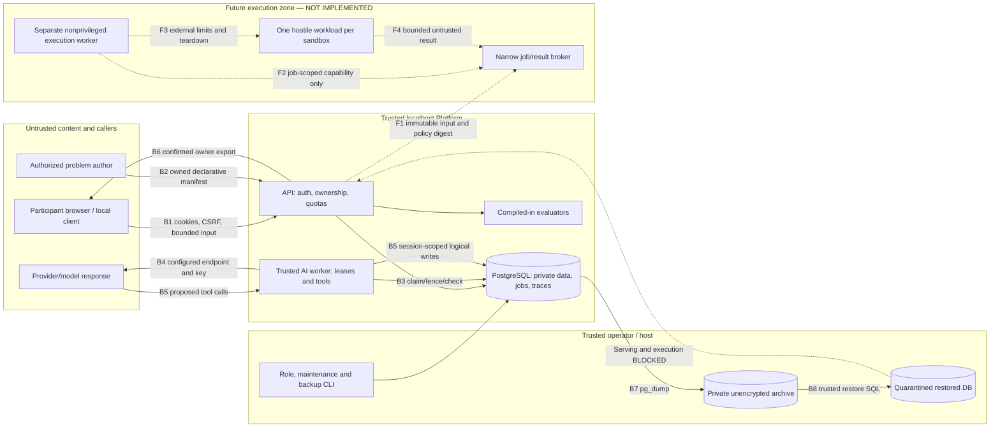

# Execution-isolation threat model

## 1. Overview

This is a source-backed M4 design document for PraxiOJ, an independent personal Apache-2.0 Framework and Platform. It describes the current localhost development preview and the additional boundaries needed **before** arbitrary contestant code, packages or external evaluators could be enabled. No executable sandbox, public deployment approval or production certification is introduced.

The review covers the mutable M4 working tree, including new operations, quota, export and backup modules. It started from an independent architecture review, then reconciled the later backup cluster-identity check and M4 security documentation. The retained independent JSON is historical evidence; this document is the current synthesis. This is architecture analysis, not a completed vulnerability audit. Source citations identify repository-relative paths and inspected lines; the snapshot footer covers the cited source inventory, not an assertion that HEAD contains all reviewed changes.

The Framework defines manifests, providers, tool authorization, trace/evaluation contracts and an unavailable execution interface. The Platform owns HTTP authorization, PostgreSQL records, job coordination and the React client. The current AI worker is trusted application code with database and provider authority. It is not the proposed execution worker. Sources: `packages/framework/src/praxioj/execution/__init__.py:36`, `packages/framework/src/praxioj/execution/__init__.py:45`, `apps/api/src/praxioj_api/worker.py:122`, `compose.yaml:95`.

| Component | Current responsibility | Source |
| --- | --- | --- |
| Browser/API | Account lifecycle, owner access, declarative problem publication, export and deletion | `apps/api/src/praxioj_api/auth_routes.py:67`, `apps/api/src/praxioj_api/security.py:19`, `apps/api/src/praxioj_api/main.py:50` |
| PostgreSQL | Accounts, solve data, jobs, admission budgets, trace checkpoints and audit | `apps/api/src/praxioj_api/database.py:8`, `apps/api/src/praxioj_api/quotas.py:38` |
| Trusted AI worker | Claim/renew leases, provider calls and logical tool orchestration | `apps/api/src/praxioj_api/worker.py:52`, `apps/api/src/praxioj_api/runs.py:251` |
| Framework tools | Explicit handler registry; permission-checked logical read/write | `packages/framework/src/praxioj/tools/__init__.py:177`, `packages/framework/src/praxioj/tools/__init__.py:230` |
| Trusted evaluator | Fixed compiled-in evaluator IDs/versions; others unsupported | `packages/framework/src/praxioj/evaluation/__init__.py:276` |
| Operator workflows | Local role assignment, manifest registration, maintenance and trusted backup/restore | `apps/api/src/praxioj_api/cli.py:11`, `apps/api/src/praxioj_api/maintenance.py:15`, `apps/api/src/praxioj_api/backup.py:72` |

### Effective resources and configuration

Values below are source defaults or formulas. Actual environment values, secrets, databases, Docker state and browser download directories were not inspected. Native commands consume the process environment; they do not themselves load a private dotenv file. Compose substitutes the named settings into a shared API/worker environment. Credentials are represented only by references.

| Deployment or workflow | Resource or capability | Configuration and precedence | Safe effective value or location | Readers, writers, or recipients | Enforcing control | Evidence or unknowns |
| --- | --- | --- | --- | --- | --- | --- |
| Native API | HTTP listener | Make target → Uvicorn | `127.0.0.1:8000`; proxy interpretation disabled | Local clients | Listener bind, Host/origin/auth controls | `Makefile:27`, `apps/api/src/praxioj_api/security.py:92` |
| Compose API | HTTP listener | Dockerfile CMD → startup script; Compose publication | Container `0.0.0.0:8000`; host `127.0.0.1:8000`; backend/local networks | Local clients and connected container peers | Loopback publication plus application checks | `apps/api/Dockerfile:13`, `scripts/start-api.sh:7`, `compose.yaml:78` |
| Native web | UI/proxy | Make/Vite | `127.0.0.1:5173`; `/api` → `http://127.0.0.1:8000` | Browser/API | Loopback bind; API remains authoritative | `Makefile:36`, `apps/web/vite.config.ts:6` |
| Compose web | Static UI/proxy | Image copies nginx configuration; Compose publication | Host `127.0.0.1:5173` → container port 80; local network | Browser/API | Loopback publication; API checks | `apps/web/Dockerfile:8`, `compose.yaml:104` |
| Native API/worker | Database | `DATABASE_URL` → Settings → engine | Default loopback `127.0.0.1:5432/praxioj`; configured role/credential reference | API, worker, local DB | Backend validation; DB privileges; bounded connection/query waits | `apps/api/src/praxioj_api/settings.py:25`, `apps/api/src/praxioj_api/database.py:8` |
| Compose API/worker | Database | Shared runtime environment | `db:5432/praxioj`, same configured role for both | API and trusted worker | Network/application controls; no separate DB authority between these processes | `compose.yaml:22`, `compose.yaml:95` |
| Compose PostgreSQL | Persistent storage/listener | Named volume and optional native override | `postgres_data` mounted at `/var/lib/postgresql`; base DB unpublished; override publishes `127.0.0.1:5432` | PostgreSQL, trusted host/Docker administrators | Volume/network access | `compose.yaml:9`, `compose.native.yaml:3`; image-defined PGDATA child and host backing path remain uninspected |
| Native provider | Network endpoint/key | Process `PRAXIOJ_LLM_BASE_URL/API_KEY` → Settings → adapter | `base_url.rstrip('/') + '/chat/completions'`; key becomes Bearer header | Configured provider and trusted worker | Endpoint validation, no proxy inheritance/redirects, deadline and byte bounds | `apps/api/src/praxioj_api/settings.py:29`, `apps/api/src/praxioj_api/runs.py:289`, `packages/framework/src/praxioj/runtime/compatible.py:68`, `packages/framework/src/praxioj/runtime/compatible.py:110` |
| Compose provider | Configuration/network | Compose interpolation → shared API/worker environment | Same provider references in both; mock default; both attach to outbound-capable local bridge | API/worker/provider | Adapter controls; not egress-denied execution | `compose.yaml:25`, `compose.yaml:89`, `compose.yaml:95`, `compose.yaml:123` |
| Logical tools | File access | Manifest allowlist/permissions → dispatcher → session store | `WorkspaceFile` rows selected by session ID and validated logical key; no host path | Owner-authorized API and leased worker | Strict schemas, permission subset, file/count/byte bounds and session lock | `apps/api/src/praxioj_api/runs.py:345`, `apps/api/src/praxioj_api/workspace.py:17`, `packages/framework/src/praxioj/tools/__init__.py:177` |
| Job worker | Execution ownership | Settings → repository claim → lease → RunManager | Default global 4 running jobs, 15-second lease, 3-second heartbeat; one active invocation per worker | Trusted worker with platform authority | Admission lock, SKIP LOCKED, token/fence/expiry/deadline; cancellation revokes ownership | `apps/api/src/praxioj_api/settings.py:63`, `apps/api/src/praxioj_api/settings.py:72`, `apps/api/src/praxioj_api/jobs.py:49`, `apps/api/src/praxioj_api/jobs.py:139`, `apps/api/src/praxioj_api/worker.py:70` |
| Admission/storage | Resource budgets | Operator caps + manifest limits → session policy | Default 10 active/100 retained sessions and 2 runs per account; 100 queued jobs; 1 MiB artifact and 8 MiB/2,000-event ordinary trace cap per session; terminal reserve adds 4 MiB/128 events | Account/problem/system operations | Atomic global/bucket locks and stores; not physical-volume/CPU isolation | `apps/api/src/praxioj_api/settings.py:67`, `apps/api/src/praxioj_api/quotas.py:19`, `apps/api/src/praxioj_api/quotas.py:45`, `apps/api/src/praxioj_api/quotas.py:68`, `apps/api/src/praxioj_api/quotas.py:211` |
| Owner export | Private attachment | Export settings → owner query → bounded writer → response → browser Blob | Default 16 MiB/10,000 records; HTTP `praxioj-account-export.json`; UI `praxioj-export-<timestamp>.json`; no server file | Recently confirmed owner/browser | Authentication, CSRF, confirmation, owner/session locks, explicit fields | `apps/api/src/praxioj_api/data_governance.py:23`, `apps/api/src/praxioj_api/data_governance.py:66`, `apps/api/src/praxioj_api/data_governance.py:129`, `apps/web/src/pages/Account.tsx:28`; download path is user/browser-controlled |
| Backup files | Whole database archive | CLI directory → absolute/resolved private directory → generated name | `<private-directory>/praxioj_<UTC timestamp>_<uuid>.dump` and matching `.json`, outside checkout; application encryption absent | Trusted OS owner/operator | Owner/mode checks, O_NOFOLLOW/O_EXCL, checksums and bounded subprocess time | `apps/api/src/praxioj_api/backup.py:37`, `apps/api/src/praxioj_api/backup.py:53`, `apps/api/src/praxioj_api/backup.py:140`, `apps/api/src/praxioj_api/backup.py:163` |
| Native backup tools | Process/DB authority | `DATABASE_URL` → engine and PATH-resolved PostgreSQL tools | Configured loopback host/port/database/role; password only in child `PGPASSWORD`; other non-PG environment is inherited | Trusted client executable/DB | Connection validation; argv list; timeout; native/tool identity comparison | `apps/api/src/praxioj_api/backup.py:73`, `apps/api/src/praxioj_api/backup.py:91`, `apps/api/src/praxioj_api/backup.py:96`, `apps/api/src/praxioj_api/backup.py:121`; PATH/other inherited environment remain operator authority |
| Container backup tools | Process/DB authority | Validated `--container` → Docker exec → PostgreSQL tools | `127.0.0.1:5432` inside selected container; SQLAlchemy still uses native URL | Docker CLI, container client, DB | Native and tool cluster ID/database/role must match before dump/restore work | `apps/api/src/praxioj_api/backup.py:22`, `apps/api/src/praxioj_api/backup.py:96`, `apps/api/src/praxioj_api/backup.py:126`; requires `pg_control_system()` permission |
| Restore verification | Historical DB | Trusted archive → verified source → new generated DB → marker → verified target → restore | `praxioj_restore_<uuid>` from template0; `praxioj_restore_quarantine`; revision `0007_operations`; failed created target retained | Trusted DB operator/archive SQL | Marker before archive SQL, schema checks, session revocation; serving/execution checks | `apps/api/src/praxioj_api/backup.py:198`, `apps/api/src/praxioj_api/backup.py:214`, `apps/api/src/praxioj_api/backup.py:216`, `apps/api/src/praxioj_api/backup.py:225`, `apps/api/src/praxioj_api/backup.py:238` |
| Future execution | Host-code capability | Framework execution/evaluator interfaces | Unavailable; methods raise or return unsupported | Trusted library caller | Fail-closed implementation | `packages/framework/src/praxioj/execution/__init__.py:45`, `packages/framework/src/praxioj/evaluation/__init__.py:276`, `packages/framework/src/praxioj/evaluation/__init__.py:297` |

### Trust boundary diagram

Solid arrows are current flows. The proposed execution zone and dashed arrows do not exist yet.

## 2. Threat Model, Trust Boundaries, and Assumptions

### Assets, actors and enforceable objectives

Protect account credentials/roles, other participants' private content, provider keys and spending authority, host/kernel integrity, job ownership, authoritative evaluation inputs/results, bounded shared capacity and deletion decisions. Trace hashes support consistency checks; a DB administrator who can rewrite events and checkpoints is outside that protection. Sources: `apps/api/src/praxioj_api/auth.py:16`, `apps/api/src/praxioj_api/auth.py:46`, `apps/api/src/praxioj_api/services.py:67`, `SECURITY.md:7`.

| Actor and starting authority | Authority they must not gain |
| --- | --- |
| Unauthenticated local caller or hostile web origin can send HTTP inputs | An authenticated session, CSRF authority, private exports or privileged mutations |
| Participant controls own text, requests and logical artifacts | Another account's data, author/admin roles, arbitrary provider URL or host execution |
| Author manages owned declarative problem versions | Imports/handlers in trusted processes, another author's problems, unrestricted participant content |
| Provider/model controls assistant text and tool proposals | Additional tool permissions, server secrets, a higher message role or host/network access through tools |
| Future contestant/package/evaluator process controls arbitrary execution inside its assigned environment | Host/neighbor resources, platform DB/provider credentials, other jobs or authoritative score/evidence writes |
| Operator/host/DB administrator controls deployment and storage | Already trusted authority; do not describe their ordinary administrative access as an exploit |

The required invariants are:

1. **B1/B2 — HTTP and ownership:** authentication, allowed-origin login, synchronizer CSRF, role checks and owner filters remain authoritative, including through local proxies. A localhost Host header is not transport-locality proof. User-first mutation locks serialize account erasure with authenticated writes. Sources: `apps/api/src/praxioj_api/security.py:19`, `apps/api/src/praxioj_api/security.py:43`, `apps/api/src/praxioj_api/security.py:92`, `apps/api/src/praxioj_api/auth_routes.py:68`, `apps/api/src/praxioj_api/auth_routes.py:212`, `apps/api/src/praxioj_api/services.py:18`.
2. **B3 — job authority:** each persisted mutation checks the live token/fence/deadline; cancellation revokes it before acknowledgement. Expired work fails without replaying a possibly billed call. This is coordination against stale workers, not protection from a malicious worker that already holds DB credentials. Sources: `apps/api/src/praxioj_api/jobs.py:49`, `apps/api/src/praxioj_api/jobs.py:70`, `apps/api/src/praxioj_api/jobs.py:86`, `apps/api/src/praxioj_api/jobs.py:179`.
3. **B4/B5 — network and tools:** participants select only configured profiles permitted by the pinned problem. Tool definition visibility is separate from dispatcher authorization; strict arguments, permissions and session-bound storage apply at execution. Provider output must be assistant-role data. Sources: `apps/api/src/praxioj_api/runs.py:92`, `apps/api/src/praxioj_api/runs.py:345`, `packages/framework/src/praxioj/tools/__init__.py:164`, `packages/framework/src/praxioj/tools/__init__.py:177`, `packages/framework/src/praxioj/runtime/compatible.py:140`.
4. **B6 — data lifecycle:** export requires recent password confirmation on the same login session and omits expired traces/credentials. Live erasure rejects active runs and removes private data in one transaction, leaving a pseudonymous ownership tombstone. Downloads and old backups remain separate copies. Sources: `apps/api/src/praxioj_api/security.py:69`, `apps/api/src/praxioj_api/data_governance.py:121`, `apps/api/src/praxioj_api/data_governance.py:129`, `apps/api/src/praxioj_api/retention.py:76`.
5. **B7/B8 — privileged restore:** accept only trusted operator archives. Verify the actual native/tool connection identities; keep the restored DB quarantined and revoke old sessions. Quarantine is checked by API startup, worker startup/iteration/claim and independent maintenance. It is not a sandbox against archive SQL or DB administrators. Sources: `apps/api/src/praxioj_api/backup.py:96`, `apps/api/src/praxioj_api/backup.py:198`, `apps/api/src/praxioj_api/main.py:54`, `apps/api/src/praxioj_api/worker.py:52`, `apps/api/src/praxioj_api/worker.py:122`, `apps/api/src/praxioj_api/jobs.py:105`, `apps/api/src/praxioj_api/maintenance.py:15`.
6. **F1–F4 — future only:** bind exact input, policy, account, session, job, attempt and fence to a narrow capability; deny secrets and default network; validate every result before brokered persistence; externally enforce resource limits and cleanup. The [architecture proposal](sandbox-architecture.md) defines acceptance evidence. No existing `ExecutionLimits` field proves host enforcement.

### Assumptions and reconciled questions

- User context authorizes an independent personal localhost preview, design documentation and synthetic validation. It does not authorize public deployment, paid inference, actual participant data or untrusted execution.
- M4 general rate admission, quotas, operations, export and backup are now represented in `SECURITY.md`. The earlier independent snapshot's M3 documentation disagreement is historical, not a current missing-feature claim. Similarly, the initial native/container backup identity obligation is now checked by `apps/api/src/praxioj_api/backup.py:96` and described at `docs/development/backup-restore.md:7`.
- Process separation, non-root image user and an internal DB network do not isolate hostile code from the current worker's credentials/outbound network. Compose explicitly shares runtime configuration and joins both worker networks: `apps/api/Dockerfile:11`, `compose.yaml:95`, `compose.yaml:102`.
- Current quotas are policy limits, not a physical disk guarantee or exact billing ceiling. Unknown/estimated provider usage retains reservations. Health probes bypass general request throttling; local proxy clients share transport-peer budgets. Sources: `apps/api/src/praxioj_api/quotas.py:134`, `apps/api/src/praxioj_api/security.py:100`.
- Backup manifests are unsigned checksums; storage encryption, OS ACLs and independently protected current deletion ledgers remain operator responsibilities. No automatic restored-DB promotion or external deletion-ledger replication exists. Sources: `apps/api/src/praxioj_api/backup.py:161`, `docs/development/backup-restore.md:42`.
- Native Windows backup ACL equivalence, image-defined PGDATA location, actual local secret/configuration values, commercial provider behavior and future isolation runtime/kernel compatibility were not verified. The future runner's supported host must be chosen and tested explicitly.
- Source inspection establishes intended enforcement paths, not that every path passed runtime testing. Existing milestone validation belongs in the [M4 validation report](../development/validation-m4.md); this document does not claim test results or vulnerability findings.

## 3. Attack Surface, Mitigations, and Attacker Stories

Every row below is a threat hypothesis/design obligation, **not a confirmed vulnerability**. P0/P1/P2 describe review priority, not established severity. The F rows require a future execution feature; they are unreachable through today's unavailable backend.

| ID / priority | Scenario and capability gain | Prerequisites / impact | Existing controls and counterevidence | Mitigation / acceptance evidence | Source |
| --- | --- | --- | --- | --- | --- |
| T1 / P0 | Caller bypasses account/role/owner checks and reads another participant's artifacts or export | Reachable local HTTP; cross-account confidentiality/integrity loss | Hashed sessions, CSRF, roles, owner predicates, confirmation | Preserve positive/negative ownership and revocation races across every new broker route; A2/A3 | `apps/api/src/praxioj_api/security.py:19`, `apps/api/src/praxioj_api/services.py:18`, `apps/api/src/praxioj_api/data_governance.py:66` |
| T2 / P1 | Hostile web page causes login swap, mutation or sensitive export | Browser reaches loopback; attacker lacks CSRF/confirmation | Explicit allowed Origin on auth; strict cookies; CSRF and same-session confirmation | Test origin/content-type/body bounds and forged forwarded headers; A2 | `apps/api/src/praxioj_api/auth_routes.py:68`, `apps/api/src/praxioj_api/security.py:43`, `apps/api/src/praxioj_api/security.py:123` |
| T3 / P0 | Prompt-injected model output selects an unregistered tool, path or elevated authority | Untrusted model response; would gain unauthorized write/host operation | Dispatcher checks allowlist and permission subset; DB-only keys; assistant-role parsing | Keep model instructions outside authorization; future execution capability must be explicit and broker-bound; A3/A9 | `packages/framework/src/praxioj/tools/__init__.py:177`, `apps/api/src/praxioj_api/runs.py:345`, `packages/framework/src/praxioj/runtime/compatible.py:148` |
| T4 / P0 | Delayed worker/result writes after cancellation or to a different job | Lost lease, duplicate/reordered delivery; stale/cross-session mutation | Token/fence/deadline verification; cancellation terminalizes; request digest binds retry | Extend binding to input/policy/image/result digests; reject stale results atomically; A3/A10 | `apps/api/src/praxioj_api/jobs.py:49`, `apps/api/src/praxioj_api/jobs.py:86`, `apps/api/src/praxioj_api/workspace_routes.py:32` |
| T5 / P1 | Participant exhausts DB, queue, provider budget, logs or export memory | Repeated permitted calls; shared availability/spend | API/auth buckets, global admission, daily reservations, export bounds, safe metric categories | Add host resource accounting for execution; measure bounded denial/cleanup under pressure; A7/A12 | `apps/api/src/praxioj_api/quotas.py:68`, `apps/api/src/praxioj_api/quotas.py:134`, `apps/api/src/praxioj_api/data_governance.py:23`, `apps/api/src/praxioj_api/operations.py:48` |
| T6 / P1 | Provider endpoint or response leaks credentials/private data | Operator-configured recipient; malicious response possible | Server-only key, no redirects/proxy inheritance, bounded response, redaction | Preserve recipient selection as operator authority; never send platform secrets into guest; A4/A6 | `packages/framework/src/praxioj/runtime/compatible.py:41`, `packages/framework/src/praxioj/runtime/compatible.py:110`, `apps/api/src/praxioj_api/runs.py:61` |
| T7 / P1 | Author gains execution through manifest/evaluator fields | Authorized author controls declarative data | Fixed compiled-in evaluator registry; immutable versions | Treat future evaluator/package as hostile code; never import it in API/AI worker; A1/A8 | `apps/api/src/praxioj_api/auth_routes.py:212`, `apps/api/src/praxioj_api/registry.py:13`, `packages/framework/src/praxioj/evaluation/__init__.py:276` |
| T8 / P1 | Export or restore resurrects expired/deleted content or old access | Historical snapshot/download exists | Export omits expired traces; live deletion atomic; quarantine and restored-session revocation | Independent deletion ledger and reviewed promotion required; client-copy limitation explicit; A11 | `apps/api/src/praxioj_api/data_governance.py:121`, `apps/api/src/praxioj_api/retention.py:76`, `apps/api/src/praxioj_api/backup.py:238`, `docs/development/backup-restore.md:42` |
| T9 / P1 | Backup command operates on a different server than its SQL checks | Wrong container/URL mapping | Native/tool cluster ID/database/role comparison, repeated for new target | Keep unavailable/mismatch fail-closed tests; trusted executable/host remains prerequisite; A11 | `apps/api/src/praxioj_api/backup.py:96`, `apps/api/src/praxioj_api/backup.py:140`, `apps/api/src/praxioj_api/backup.py:198`, `apps/api/src/praxioj_api/backup.py:216` |
| F1 / P0 | Malicious code/dependency escapes container or guest and reaches host | Future runner enabled; kernel/runtime vulnerability or unsafe setup | Current backend unavailable; ordinary current worker has broad authority | Separate host/service identity; evaluated microVM or gVisor boundary; patching, no privileged containers/socket; A4/A5 | `packages/framework/src/praxioj/execution/__init__.py:45`; proposed architecture below |
| F2 / P0 | Code reads credentials, DB volumes or another session via filesystem/process state | Future mount/env/proc leakage | No current host-path tool | Explicit empty environment allowlist; fresh per-job storage; no platform mounts; no cross-job reuse; A4/A5 | `apps/api/src/praxioj_api/workspace.py:1`; future controls in proposal |
| F3 / P0 | Artifact output escapes collection root using traversal, links or special files | Future artifact collector parses hostile bytes/files | Current paths are only logical keys | Descriptor-relative regular-file collection, no link following, quotas/digests, isolated archive parser or reject archives; A9 | `packages/framework/src/praxioj/tools/__init__.py:19`; future collector absent |
| F4 / P0 | Guest accesses host services, metadata or another tenant over network | Future network access or accidental bridge membership | Current provider network is intentionally available only to trusted runtime | Default no network device/route; independent egress control; optional broker never forwards credentials; A6 | `compose.yaml:102`, `packages/framework/src/praxioj/runtime/compatible.py:118` |
| F5 / P0 | Fork/CPU/memory/disk/output abuse stalls the platform or survives cancellation | Future arbitrary process execution | Application quotas do not stop hostile processes | Externally enforce process-tree/VM and storage limits, bounded output, independent watchdog/reaper; A7/A10 | `apps/api/src/praxioj_api/quotas.py:134`, `packages/framework/src/praxioj/execution/__init__.py:10` |
| F6 / P0 | Forged evaluator output or protocol payload changes scores, ownership or evidence | Future external evaluator/result channel | Current scoring is compiled-in; trace checkpoint is server-owned | Separate contestant and evaluator sandboxes; strict result schema; broker determines authority, IDs and trace events; A3/A8/A9 | `packages/framework/src/praxioj/evaluation/__init__.py:276`, `apps/api/src/praxioj_api/services.py:67` |
| F7 / P1 | Compromised package/image/build hook executes before confinement | Future dependency installation/build pipeline | Today author manifests do not install packages | Digest-pinned reviewed images; offline package cache; build hooks run inside an equally isolated build job; A8 | `apps/api/src/praxioj_api/registry.py:35`; future packaging controls absent |

No prompt instruction alone mitigates F1–F7. The proposed enforcement owners, numerical candidate limits, failure behavior and measurable A1–A12 acceptance gates are in [sandbox-architecture.md](sandbox-architecture.md).

## 4. Severity Calibration (Critical, High, Medium, Low)

Severity requires a demonstrated boundary failure, credible prerequisites and concrete new authority. Confidence is a separate judgment about evidence. Localhost limits exposure but does not erase a real cross-account or host compromise.

| Severity | Repository-specific example if validated | Counterexample or prerequisite that changes the judgment |
| --- | --- | --- |
| Critical | A future ordinary contestant obtains host/root or broad platform credentials and controls all accounts through a repeatable runner escape | Future runner must actually be enabled/reachable. A trusted host administrator reading its own DB, or an unavailable execution contract, is not this finding |
| High | A participant exports another account's content, bypasses author/admin restrictions, or a future job reads another job's private inputs/secret material | Establish ownership bypass and sensitive impact; a model merely proposing a denied tool call is counterevidence |
| Medium | Reproducible modest-cost requests cause sustained shared service loss, or a bounded sensitive metadata disclosure without broad account access | Distinguish shared impact from the caller exhausting its own permitted quota; quantify workload, duration, recovery and existing admission controls |
| Low | A limited metadata/error leak or narrow defense-in-depth regression with minor demonstrated consequence | Missing preferred hardening without a reachable new capability is a design task, not automatically a vulnerability |

Backups deliberately contain private data and can execute trusted source SQL on restore. Severity is not assigned merely because an authorized operator can read that archive. Conversely, exposure of an archive to an unauthorized caller would create a genuine confidentiality boundary failure. An adjacent checksum is not a malicious-operator signature.

Reviewed; no justified optimization for this documentation change. It adds no runtime path. Future backend choice requires comparable cold-start, memory, throughput, cancellation and cleanup measurements; no performance or security superiority is claimed without those measurements. Runtime tests were not run by the architecture reviewer.

Repository: sha256:26d1dcf42ae768e0b6f3bd22ae45da2243bb8d6ede25b3d1dfce0fe1e8d34b0f
Version: codex-security-snapshot/v1:sha256:11259cce10e2af1c0705ca72111c06fb877d1905b31219cf045ffe488fbdbf2b
