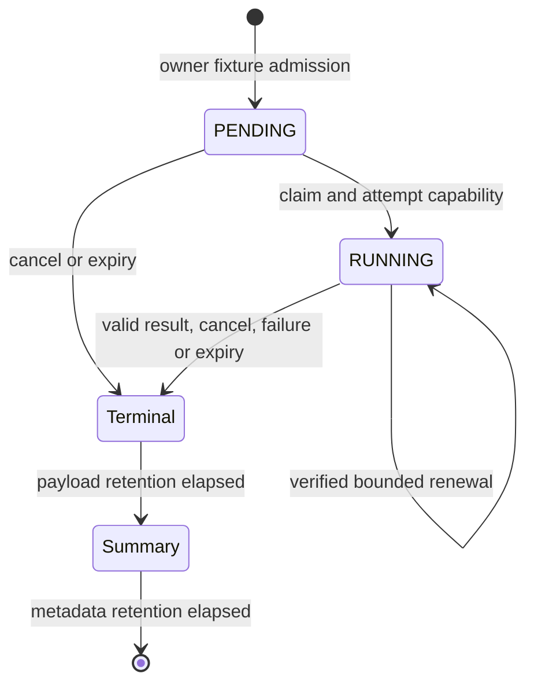

# Judge 수명주기와 제한된 증거 보존

[English](../../../architecture/judge-lifecycle.md) · [문서 목차](../index.md)

## 개요와 범위

M6-A는 M5 합성 Broker에 확인 응답이 있는 Lease 갱신, Dispatch Heartbeat Loop와 2단계 종료 이력 정리를 추가한다. 이 문서는 구현을 설명하며 테스트 결과와 전달 상태는 [M6-A 검증](../development/validation-m6a.md)에 기록한다. [Issue #17](https://github.com/casing1/praxioj/issues/17), [#18](https://github.com/casing1/praxioj/issues/18), [#21](https://github.com/casing1/praxioj/issues/21)이 수용 기준을 추적한다.

Judge의 기본값은 `unavailable`이다. 명시적인 `mock` 모드에서는 관리자 자신이 제출한 고정 Fixture만 허용한다. 기존 AI Job·Provider 예산·원래 Evaluation 점수·Trace Checkpoint는 별도로 유지한다. 실행 서비스, 임의 코드, Host Process, Network Transport나 OS Sandbox를 추가하지 않는다. [Linux 사전 점검](../development/linux-runner-preflight.md)은 남은 M6-B Host 수용 조건을 설명한다.

## 권한과 갱신

신뢰하는 Broker가 DB 권한을 유지한다. `JudgeLease`는 Job·Attempt·Worker·Fence, 불투명 Result Token과 실행 요청을 고정한다. `renew(lease)`는 `JudgeRenewal` 확인 응답 또는 `None`을 반환한다. M5의 `heartbeat(lease) -> bool` 호환 인터페이스도 유지한다. 확인 응답에는 DB가 관찰한 서버 시간, 현재 Lease 만료, Capability 만료와 고정 Attempt Deadline이 담긴다. Client Timestamp로 권한을 연장하지 않는다.

갱신은 User → SolveSession → JudgeJob → JudgeAttempt 순서로 Lock을 획득하고 현재 활성 관리자, 소유자·Source, Token Hash, 현재 Attempt·Worker·Fence, 미소비·미폐기 상태, 고정 Request·Policy·Image·Input 식별자, 사용 가능한 Trace와 만료 여부를 확인한다. PostgreSQL은 Lock 이후 `clock_timestamp()`를 사용하므로 Lock 대기 중 만료된 작업을 Transaction 시작 시간으로 승인할 수 없다. Source 검증 이후에도 시간을 다시 확인해 만료된 Lease가 되살아나지 않게 한다. 갱신은 원래 Attempt Deadline과 Capability 만료를 넘지 않는다. 잘못된 Token은 유효한 작업을 종료시키지 못한다. 현재 유효한 Capability가 확인됐지만 Source나 권한이 만료된 경우 종료 전이를 Commit하여 안전하게 실패하고 활성 예약을 반환한다.

Dispatcher는 Backend를 기다리는 동안 설정 Lease의 1/3 간격으로 갱신 작업을 실행한다. 완료·실패 처리 전에 갱신을 중단하고 종료를 기다리며 갱신 권한을 잃으면 로컬 Mock 대기를 취소한다. Backend 실행을 기다리는 동안 DB Transaction이나 Connection을 계속 점유하지 않는다. 현재 합성 Dispatch 대기는 30초로 제한하며, Admission은 최대 60초의 Job Deadline을 고정하고 Trace 만료가 더 이르면 그 시점을 적용한다. 개발 Harness 제한이며 임의 길이의 Worker 지원이나 엄격한 실시간 종료 보장이 아니다. DB Lock·Statement 제한도 적용된다.

취소·완료는 같은 Lock 순서를 유지한다. 먼저 Commit한 종료 전이가 이기며 Fence 증가, Attempt 폐기와 활성 Output 예약 반환을 한 번 수행한다. Worker가 중단되면 Lease가 만료되고 독립 유지보수가 실행을 자동 재시도하지 않고 복구 처리한다. 지연·Replay·취소 이후 결과는 수용된 평가를 덮어쓰지 못한다. M6-A도 Job당 Attempt 1개이며 새 작업은 명시적으로 생성한다.

## 상태와 증거 수명

`Terminal`은 `COMPLETED`·`FAILED`·`CANCELLED`를 가리킨다. `Summary`는 `evidence_purged_at`이 기록된 종료 Row이며 실행 가능한 Job 상태가 아니다.

| 정책 (`PRAXIOJ_` 접두사) | 기본값 | 동작 |
| --- | --- | --- |
| `JUDGE_LEASE_SECONDS` | 15 | 갱신 간격은 Lease/3이며 허용 Lease는 1–60초 |
| `JUDGE_RESULT_RETENTION_DAYS` | 7 | 조건을 충족한 종료 Result·Request·Attempt Payload 제거 |
| `JUDGE_METADATA_RETENTION_DAYS` | 30 | 조건을 충족한 종료 Summary 삭제 |
| 보존 설정 검증 | `1 <= result <= metadata <= 90` | 정수 일수이며 미지원 설정은 거부 |
| Payload 용량 | 기본 계정별 32개·시스템 256개 | 기존 Retained Job 설정으로 증거를 아직 Purge하지 않은 Job 수를 제한 |
| Metadata 용량 | Retained Job 설정의 4배 | Summary를 포함한 전체 Row 수 제한. 보호할 이력을 조기 삭제하지 않고 Admission에 429 반환 |

첫 보존 기한에 도달하면 Cleanup은 Result Byte, 고정된 비공개 Request와 Capability Hash를 포함한 Attempt Record를 제거한다. 안전한 합성 평가, 식별자·Digest 참조와 수명주기 Timestamp는 유지한다. 공개 Job·Assessment 응답은 `evidence_status="unavailable"`과 Purge Timestamp를 표시한다. Purge 전 `available`은 저장된 Judge Result Envelope와 생성된 경우 그 Inline Artifact가 남아 있다는 의미이며 Artifact가 반드시 생성됐다는 뜻은 아니다. `not_produced`는 Judge 결과가 생성되지 않았음을 뜻한다. 이 필드는 독립 실행이나 현재 Trace 가용성을 입증하지 않는다. Trace 보존은 Export·Integrity View에서 별도로 표시한다.

Metadata 보존 기한에는 Job과 합성 평가 Summary를 제거한다. 원래 Submission·기본 Evaluation·Trace는 유지한다. 이력을 완전히 삭제한 뒤에는 예전 Request UUID를 기억하지 않는다. Source가 여전히 허용 조건을 충족하면 새 Admission이 새로운 Job UUID를 생성할 수 있다. 이전 Attempt Token이 새 Job에 유효해지는 것은 아니다. 영구 Idempotency Ledger는 없다.

## Cleanup·할당량·데이터 관리

`JudgeBroker.purge_history(limit)`는 Judge Backend 없이 실행한다. Maintenance는 만료된 권한을 먼저 복구 처리한 뒤 기존 운영 작업과 함께 제한된 이력 정리를 수행한다. 독립 Maintenance 일정은 운영자가 구성해야 하며 TTL이 지났다는 사실만으로 정확한 시각에 물리 삭제가 완료됨을 보장하지 않는다. [로컬 설정](../../../development/local-setup.md)의 기존 Maintenance 명령을 사용한다.

Cleanup 후보 Query는 종료 `finished_at, id` 순서이며 조건부 보존 Index가 있다. 각 후보를 User → Session → Job → Attempt Lock 안에서 다시 확인한다. 이미 Lock된 소유자·세션은 건너뛴다. 활성 Job, 아직 보존 기한이 남은 증거, 폐기·소비되지 않았고 만료도 지나지 않은 Capability 권한을 가진 비정상 종료 Record를 보존한다. 제공받은 Cutoff·Runner Clock 대신 현재 DB 시간을 사용한다. 큰 일괄 삭제보다 안전성과 재실행 가능성을 우선하는 제한된 Job별 Transaction을 사용한다.

Payload Purge는 보존 Payload 용량을 반환한다. 종료 전이 또는 검사를 거친 정합성 복구는 활성 Output 예약을 반환한다. Summary Row는 별도로 제한한다. 반복·동시 Cleanup은 상태를 다시 확인하고 통제된 Audit 식별자·개수를 남기며 용량을 중복 반환하지 않는다. Audit에 원본 Result·Request·Token을 넣지 않는다. 계정 삭제는 활성 Judge 작업을 계속 거부하며 종료 이후 남은 비공개 이력을 Cascade 삭제한다. 복구 DB의 Quarantine은 권한·Cleanup 진입점에서 유지한다.

Migration `0009_judge_lifecycle`는 `0008_judge_execution` 다음으로, Nullable Purge Marker와 종료 보존 Index를 추가하며 기존 M5 Record를 보존한다. Readiness와 Backup Schema 검증은 새 Head를 요구한다. Upgrade 전에 기존 정책에 따라 운영자가 관리하는 Backup을 보존한다. 의도적으로 Purge한 증거는 Schema Downgrade로 재구성할 수 없으므로 보존·데이터 복구와 코드 Rollback을 별도로 검토한다. 과거 Backup·비공개 Export에는 기존 독립 수명주기 한계가 유지된다.

## 호환성·검증·한계

M5 Request·Result 버전 1.0, Boolean Heartbeat, 고정 합성 Route와 원래 채점을 유지한다. 안전한 증거 필드는 추가 확장이다. 별도의 [Runner 프로토콜](../../../specifications/runner-protocol.md)은 Mock에 DB·원래 Broker 자격증명을 전달하지 않고 확인 응답을 사용한다.

필수 테스트는 갱신 성공·만료, 잘못된 Token·Worker·Fence·Source, Replay·취소·장애·지연 결과, Loop 종료, 보존 경계, 활성 권한 보호, 멱등성, 할당량·Summary 상한, Export·계정 삭제, Migration·Quarantine과 실제 PostgreSQL 경쟁을 포함한다. SQLite는 Row Lock 동작을 입증하지 못한다. 실제 명령·개수·Skip·독립 검토 결과는 이 문서에서 추정하지 않고 검증 보고서에 기록한다.

별도 최적화 검토는 확보한 M5 부하와 Heartbeat SQL·지연을 비교하고 Claim·Cleanup·Index·직렬화·Lock 비용을 살핀다. 권한 검사를 제거하는 것은 최적화가 아니다. 이 설계 문서는 애플리케이션 속도·격리 개선을 주장하지 않는다. CPU·Memory·PID·Disk·Egress 강제, Guest 종료·정리, 인증된 원격 배포와 실제 비신뢰 코드 실행은 M6-B에 남는다.

## 참고

- [M5 Broker 구조](../../../architecture/execution-broker.md), [실행 프로토콜](../../../specifications/execution-protocol.md)
- [데이터 관리](../../../development/data-governance.md), [Backup·Restore](../../../development/backup-restore.md)
- [M6-A Milestone](https://github.com/casing1/praxioj/milestone/1), [Open M6-B](https://github.com/casing1/praxioj/milestone/2)
